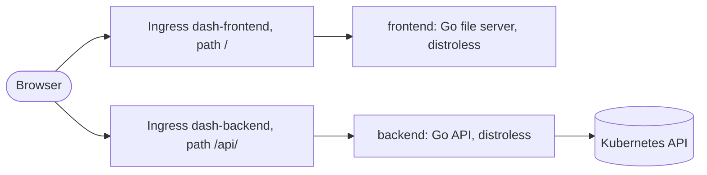

# Dash

[](https://github.com/guided-traffic/dash/actions)
[](https://github.com/guided-traffic/dash)
[](https://goreportcard.com/report/github.com/guided-traffic/dash)
[](LICENSE)

**A start page for a Kubernetes cluster that finds its apps through their Ingresses**, in the look of
[Cogpit](https://github.com/guided-traffic/cogpit): calm when every app is healthy, lit where one is
not. Installed by one Helm chart, configured entirely through it, no login.

> **Phase 2 of 3, in progress.** Built: both images, the chart with its two Ingress objects, the
> pipeline, the shell with its colour scheme, and the dashboard's complete configuration — every key
> below is validated by the chart and the backend. **Nothing reads the dashboard's keys yet**:
> discovery, icons, badges and the dashboard page arrive step by step, as phase 2 of the
> [project plan](docs/planning/project-plan.md) lists them.



## ✨ Key Features

- 🧭 One origin, two Ingress objects: the UI on `/`, the API on `/api/`, the controller the only hop.
- 🛡️ Distroless images, non-root, read-only, no shell — proven in CI for each image.
- 🌗 Light, dark or the system's scheme, remembered by the browser, applied before the first paint.
- 📜 A spec-first API: OpenAPI 3.1, validated requests, RFC 9457 problem bodies.
- ⚙️ Every setting through the chart, refused at install when wrong (`values.schema.json`).

## 📛 Naming conventions

| What | Name |
|---|---|
| Images | `guidedtraffic/dash-backend`, `guidedtraffic/dash-frontend` |
| Chart, repository | `dash`, `https://guided-traffic.github.io/dash/` |
| Resources | `<fullname>-backend` (Deployment, Service, Ingress, ServiceAccount), `<fullname>-frontend` (Deployment, Service, Ingress), `<fullname>-config` (ConfigMap) |
| Annotations | `dash.gtrfc.com/<key>` — read by the discovery from phase 2; the chart puts `dash.gtrfc.com/enable: "false"` on its own Ingress objects |
| Backend variables | `DASH_CONFIG`, `DASH_LISTEN_ADDR`, `DASH_LOG_LEVEL` |
| Configuration file | `/etc/dash/config.yaml` |
| Browser storage | `dash.theme` |
| API | `/api/v1/` |

## 📚 Documentation

| Where | What |
|---|---|
| [docs/developer/](docs/developer/README.md) | How the code works, building, testing, CI, conventions |
| [docs/security/](docs/security/README.md) | Trust boundaries, privilege footprint, exposure without a login |
| [docs/adr/](docs/adr/README.md) | Every decision and what it rejected |
| [docs/planning/project-plan.md](docs/planning/project-plan.md) | The phases still to come |
| [SECURITY.md](SECURITY.md) | Reporting a vulnerability |

## 🚀 TL;DR

```bash
helm repo add dash https://guided-traffic.github.io/dash/
helm repo update
helm install dash dash/dash --namespace dash --create-namespace \
  --set ingress.enabled=true \
  --set ingress.className=haproxy \
  --set 'ingress.hosts[0]=dash.example.com'
```

Verify: `https://dash.example.com/` shows the shell with the backend's version beside the title, and
`https://dash.example.com/api/v1/version` answers with JSON.

> **Protect it.** Dash has no login. Put it on an internal Ingress class, or set authentication
> annotations under `ingress.annotations` — **not** under `ingress.frontend.annotations` alone, which
> would leave `/api/` open ([docs/security/exposure.md](docs/security/exposure.md)).

<details>
<summary>Upgrade and uninstall</summary>

```bash
helm repo update && helm upgrade dash dash/dash --namespace dash --reuse-values
helm uninstall dash --namespace dash
```

</details>

## 📖 Full reference

### Helm values

<details>
<summary>Every value with its default</summary>

```yaml
nameOverride: ""          # default
fullnameOverride: ""      # default
imagePullSecrets: []      # default; example: [{name: regcred}]

backend:
  image:
    repository: guidedtraffic/dash-backend   # default
    tag: ""                                  # default: the chart's appVersion
    pullPolicy: IfNotPresent                 # default; Always | IfNotPresent | Never
  replicas: 1                                # default
  logLevel: info                             # default; debug | info | warn | error
  resources:                                 # default
    requests: { cpu: 10m, memory: 64Mi }
    limits: { memory: 256Mi }                # also the Go runtime's GOMEMLIMIT
  podLabels: {}                              # default; example: { gnp/k8s-api-access: "" }
  podAnnotations: {}                         # default
  nodeSelector: {}                           # default
  tolerations: []                            # default
  affinity: {}                               # default

frontend:
  image:
    repository: guidedtraffic/dash-frontend  # default
    tag: ""                                  # default: the chart's appVersion
    pullPolicy: IfNotPresent                 # default
  replicas: 1                                # default
  resources:                                 # default
    requests: { cpu: 5m, memory: 16Mi }
    limits: { memory: 64Mi }
  podLabels: {}                              # default
  podAnnotations: {}                         # default
  nodeSelector: {}                           # default
  tolerations: []                            # default
  affinity: {}                               # default

serviceAccount:            # the backend's identity towards the Kubernetes API
  create: true             # default
  name: ""                 # default: <fullname>-backend when created, "default" when not
  annotations: {}          # default

ingress:
  enabled: false           # default
  className: ""            # default; example: haproxy
  hosts: []                # default; example: [dash.example.com]; empty: one rule without a host
  tls: []                  # default; example: [{ secretName: dash-tls, hosts: [dash.example.com] }]
  annotations: {}          # default; on both objects — authentication belongs here
  frontend:
    annotations: {}        # default; on <fullname>-frontend only, e.g. cert-manager.io/cluster-issuer
  backend:
    annotations: {}        # default; on <fullname>-backend only, e.g. a longer API timeout

# The dashboard. discovery, ui, apps, bookmarks, icons (without configMap and existingConfigMaps)
# and badges are rendered as they are into <fullname>-config, the backend's configuration file.

discovery:                 # which Ingresses become apps; annotations under dash.gtrfc.com/ only
  enabled: true            # default; false: no discovery, apps and bookmarks only
  defaultEnable: false     # default; true: every selected Ingress unless dash.gtrfc.com/enable: "false"
  instanceName: ""         # default; example: home — then only Ingresses whose dash.gtrfc.com/instance lists it
  namespaceSelector:
    any: true              # default; every namespace. false: matchNames united with labelSelector's matches
    matchNames: []         # default; example: [monitoring, media] — needs any: false
    labelSelector: {}      # default; example: { matchLabels: { dash.example.com/listed: "true" } } — needs any: false

ui:
  title: Dash              # default; at most 64 characters
  greeting:
    enabled: true          # default; the time of day and a name under the title
    name: You              # default
  defaultTheme: system     # default; system | light | dark, until a person picks one (kept as dash.theme)
  refreshSeconds: 60       # default; 5 to 3600: how often the page asks for the dashboard again
  showSummary: true        # default; the health header, a token per app
  showApps: true           # default
  showAppGroups: true      # default; false: one grid without group heads
  showAppUrls: true        # default; the URL under each app's name
  showAppInfo: false       # default; each app's description
  showAppStatus: true      # default; degraded and down apps light up
  showBookmarks: true      # default
  showBookmarkGroups: true # default
  alwaysTargetBlank: false # default; true: every app and bookmark opens in a new tab
  groupOrder: []           # default; example: [monitoring, home] — first, in this order; the rest by name

apps:                      # default: []; apps no Ingress describes. Example:
  - group: tools           # each group once, at most 64 characters
    apps:
      - name: Router                         # required
        url: https://192.168.1.1             # required; http or https, no user or password
        icon: material-symbols:router        # default: auto-match by name, then icons.defaultAppIcon
        info: The edge router                # default: ""; at most 120 characters
        targetBlank: true                    # default: false
        badges: [home, "text:lan@bottom-left"]  # default: []; see badges

bookmarks:                 # default: []. Example:
  - group: docs
    bookmarks:
      - name: Kubernetes                     # required
        url: https://kubernetes.io/docs      # required; http or https, no user or password
        icon: si:kubernetes                  # default: icons.defaultBookmarkIcon
        targetBlank: true                    # default: false
        badges: [world]                      # default: []

icons:
  defaultAppIcon: material-symbols:apps        # default; a catalogue icon or configmap:<key>, never a URL
  defaultBookmarkIcon: material-symbols:bookmark  # default
  autoMatch:
    enabled: true                              # default; an app without an icon gets the logo of its name
    catalogs: [selfhst, dashboard-icons]       # default; searched in this order
  configMap:
    files: {}              # default; example: { billing.jpg: <base64> } — rendered into <fullname>-icons, used as configmap:billing.jpg
  existingConfigMaps: []   # default; example: [team-icons] — ConfigMaps of the release namespace whose keys are icons
  remote:                  # icons named by a URL, downloaded by the backend, served from the dashboard's origin
    enabled: true          # default
    fromAnnotations: true  # default; also the URLs Ingress annotations name — see the security notes
    allowPrivateNetworks: false  # default; true: hosts at loopback, private and link-local addresses too
    allowedHosts: []       # default; example: [icons.home.arpa] — fetched at any address, over http too
    maxBytes: 262144       # default; 1024 to 4194304 bytes per icon
    timeout: 20s           # default; 1s to 2m per download
    maxEntries: 512        # default; 1 to 10000 icons kept

badges:                    # pills on icons in the style of macOS dock badges
  definitions: {}          # default. Example:
  #   world: { icon: "material-symbols:public", label: reachable worldwide, tone: cyan }
  #   home:  { icon: "material-symbols:home", label: local network only }   # tone default: neutral
  #   beta:  { text: beta, label: beta release, tone: amber }
  # Each: icon (a glyph of mdi, material-symbols or si) or text (1 to 8 characters, no ',' or '@');
  # label (required: the tooltip and what a screen reader says); tone: neutral | blue | cyan | mint | amber | coral.
  rules: []                # default; in order. Example:
  #   - match: { ingressClassNames: [external] }
  #     badge: world
  #   - match: { ingressControllers: [haproxy-ingress.github.io/controller], hosts: ["*.home.arpa"] }
  #     badge: home
  #     corner: bottom-left  # default: top-right; also top-left, bottom-right
  # match fields, all optional, every one set must hold: ingressClassNames, ingressControllers,
  # namespaces, hosts (globs), labels (a label selector), annotations (exact values),
  # kinds (ingress | app | bookmark). An item's own badges — the badges list above, the annotation
  # dash.gtrfc.com/badges — are entries "name", "name@corner", "text:<value>", "text:<value>@corner";
  # one badge per corner, the item's own first.
```

**Security notes.** `ingress.annotations` reach both objects; an authentication annotation in one
object's own set protects only that half. Both pods run as 65532 on a read-only root file system with
every capability dropped; the frontend mounts no ServiceAccount token. With `cert-manager`, put the
issuer annotation under `ingress.frontend.annotations` only: both objects name the same TLS secret,
and one Certificate is made for it (verified with cert-manager v1.21.3 and haproxy-ingress 0.16.2).

`apps[].apps[].url` and `bookmarks[].bookmarks[].url` take `http` and `https` only — a `javascript:`
link would run on the dashboard's origin — and refuse a user or password, which every viewer would
see ([docs/security/validation.md](docs/security/validation.md)). `icons.remote.fromAnnotations` lets
whoever may annotate an Ingress in a watched namespace make the backend send a request;
`allowPrivateNetworks` and `allowedHosts` widen where those requests may go.

</details>

### Backend configuration

| Variable | Default | Meaning |
|---|---|---|
| `DASH_CONFIG` | `/etc/dash/config.yaml` | The YAML file. Missing at the default path: the defaults apply; missing where the variable points: the backend refuses to start |
| `DASH_LISTEN_ADDR` | `:8080` | `host:port` the server binds |
| `DASH_LOG_LEVEL` | `info` | `debug`, `info`, `warn` or `error` |

The YAML file holds the keys `discovery`, `ui`, `apps`, `bookmarks`, `icons` and `badges` of the Helm
values above, with the same meaning and the same defaults; of `icons`, `configMap` and
`existingConfigMaps` are the chart's and not in the file. The chart renders it into
`<fullname>-config`. A key the file leaves out keeps its default; a key it does not know is refused.
The backend validates what `values.schema.json` cannot express — a badge rule naming a definition
that does not exist, a group listed twice, a corner taken twice — and refuses to start on any
problem, naming every invalid variable and key with its line at once, never echoing a value:

```text
dash: invalid configuration:
  /etc/dash/config.yaml: line 3: ui.defaultTheme: must be system, light or dark
  /etc/dash/config.yaml: line 9: badges.rules[0].badge: must name a definition of badges.definitions
```

### Endpoints

| Path | Served by | Answer |
|---|---|---|
| `/api/v1/version` | backend | `{"version","commit","build_time"}` |
| `/api/v1/openapi.json` | backend | The API document |
| `/healthz` | backend, frontend | `200 {"status":"ok"}` while the process serves |
| `/readyz` | backend | `200` once the Kubernetes API server has answered since the start, `503 not_ready` before |

### Problem codes

Every API error is an RFC 9457 `application/problem+json` body with a stable `code` and the request id.

<!-- problem-codes:start -->
| `code` | Status | Meaning |
|---|---|---|
| `validation_failed` | 400 | The request does not match the API document: an unknown query parameter, or a value the document refuses; `errors[]` names each |
| `not_found` | 404 | No such route. The frontend's file server answers the same for an `/api/` path that reached it instead of the backend |
| `method_not_allowed` | 405 | The path exists with other methods; `Allow` names them |
| `internal` | 500 | Something failed inside the backend; the `request_id` finds it in the log |
| `not_ready` | 503 | The backend has not reached the Kubernetes API server since it started (`/readyz`) |
<!-- problem-codes:end -->

## 🛠 Development

```bash
make help                 # every target
make test                 # Go unit tests of both modules and the frontend's
make lint frontend-lint   # static analysis
make e2e                  # the end-to-end suite in a kind cluster of its own
```

More in [docs/developer/](docs/developer/README.md).

## License

[Apache License 2.0](LICENSE). Third-party material: [ATTRIBUTION.md](ATTRIBUTION.md).
