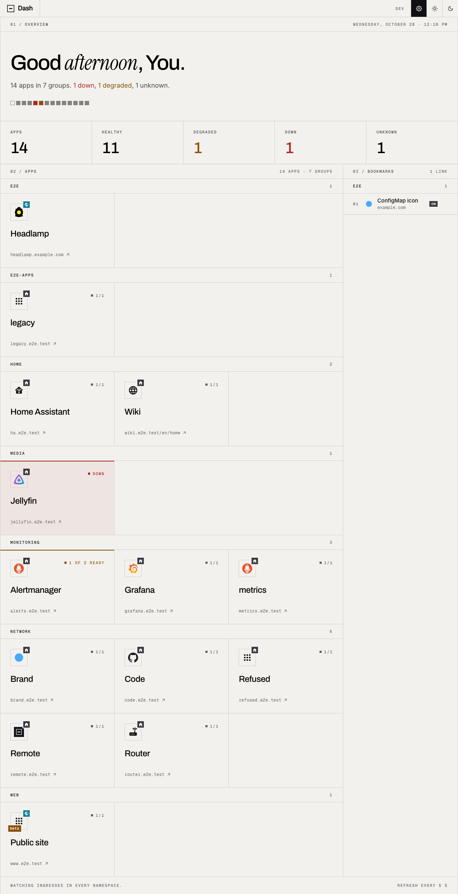
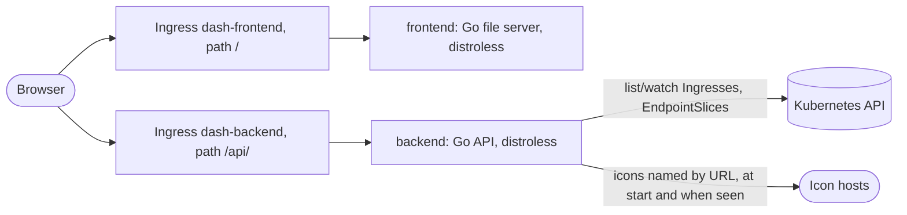

# Dash

[](https://github.com/guided-traffic/dash/actions)
[](https://github.com/guided-traffic/dash)
[](https://goreportcard.com/report/github.com/guided-traffic/dash)
[](LICENSE)

**A start page for a Kubernetes cluster that finds its apps through their Ingresses**: the apps beside
your bookmarks on a quiet page of hairlines, colour only where an app is not healthy. Installed by one
Helm chart, configured entirely through it, no login.

<picture>
  <source media="(prefers-color-scheme: dark)" srcset="docs/images/dashboard_dark.png">
  
</picture>

> **Released: 0.4.0.** The dashboard is complete — discovery, icons, badges, the page. How a cluster
> switches over is the section *Moving from Hajimari* below.



## ✨ Key Features

- 🔎 Apps found through their Ingresses with Hajimari's annotation keys under `dash.gtrfc.com/`, watched, not polled.
- 🚦 Readiness counted from EndpointSlices, each pod once: healthy, degraded, down or unknown.
- 🖼️ An icon for every app: ~28,000 glyphs and ~5,100 app logos bundled, a logo found by the app's name, your own images from ConfigMaps or URLs — all served from the dashboard's origin, checked and inert.
- 🏷️ Badges on icons, macOS style: a globe for an external IngressClass, a house for an internal one — from rules or an Ingress's own annotation.
- 🔐 Read-only RBAC that follows the namespace selector: cluster-wide, or a Role per named namespace.
- 🧭 One origin, two Ingress objects: the UI on `/`, the API on `/api/`, the controller the only hop.
- 🛡️ Distroless images, non-root, read-only, no shell — proven in CI for each image.
- 🗂️ The apps beside the bookmarks: hairline grids, quiet while every app is healthy, a line and a word where one is not, a summary with a square per app.
- 🌗 Light, dark or the system's scheme, remembered by the browser, applied before the first paint.
- 📜 A spec-first API: OpenAPI 3.1, validated requests, RFC 9457 problem bodies.
- ⚙️ Every setting through the chart, refused at install when wrong (`values.schema.json`).

## 📛 Naming conventions

| What | Name |
|---|---|
| Images | `guidedtraffic/dash-backend`, `guidedtraffic/dash-frontend` |
| Chart, repository | `dash`, `https://guided-traffic.github.io/dash/` |
| Resources | `<fullname>-backend` (Deployment, Service, Ingress, ServiceAccount), `<fullname>-frontend` (Deployment, Service, Ingress), `<fullname>-config` (ConfigMap), `<fullname>-icons` (ConfigMap, when `icons.configMap.files` holds a file) |
| RBAC | `<release namespace>-<fullname>`: the ClusterRole and ClusterRoleBinding, or the Role and RoleBinding in each named namespace; `<release namespace>-<fullname>-ingressclasses` while badge rules exist |
| Annotations | `dash.gtrfc.com/<key>` ([the keys](#annotations)); the chart puts `dash.gtrfc.com/enable: "false"` on its own Ingress objects |
| Backend variables | `DASH_CONFIG`, `DASH_ICON_PACKS`, `DASH_ICON_CONFIGMAPS`, `DASH_LISTEN_ADDR`, `DASH_LOG_LEVEL` |
| Configuration file | `/etc/dash/config.yaml` |
| Icon packs in the image | `/usr/share/dash/icons/<catalogue>.zip` |
| Icon ConfigMaps in the backend pod | `/etc/dash-icons/<configmap>/<key>`, referenced as `configmap:<key>` |
| Icon addresses | `/api/v1/icons/<catalogue>@<version>/<name>.svg`, `/api/v1/icons/blob/<sha256>.<png\|svg>` |
| Browser storage | `dash.theme` |
| API | `/api/v1/` |

## 📚 Documentation

| Where | What |
|---|---|
| [docs/developer/](docs/developer/README.md) | How the code works, building, testing, CI, conventions |
| [docs/security/](docs/security/README.md) | Trust boundaries, privilege footprint, exposure without a login |
| [docs/adr/](docs/adr/README.md) | Every decision and what it rejected |
| [docs/planning/project-plan.md](docs/planning/project-plan.md) | The phases still to come |
| [SECURITY.md](SECURITY.md) | Reporting a vulnerability |

## 🚀 TL;DR

```bash
helm repo add dash https://guided-traffic.github.io/dash/
helm repo update
helm install dash dash/dash --namespace dash --create-namespace \
  --set ingress.enabled=true \
  --set ingress.className=haproxy \
  --set 'ingress.hosts[0]=dash.example.com'
```

**Show an app** — annotate its Ingress (with `discovery.defaultEnable: true`, every Ingress shows unless
it says `"false"`):

```yaml
metadata:
  annotations:
    dash.gtrfc.com/enable: "true"
    dash.gtrfc.com/appName: Grafana        # default: the Ingress's name
    dash.gtrfc.com/group: monitoring       # default: the namespace
    # no icon: the logo of Grafana is found by its name
```

**Add your own apps and bookmarks** — in the values:

```yaml
apps:
  - group: tools
    apps:
      - { name: Router, url: "https://192.168.1.1", icon: "material-symbols:router" }
bookmarks:
  - group: docs
    bookmarks:
      - { name: Kubernetes, url: "https://kubernetes.io/docs", icon: "si:kubernetes" }
```

**Tell external apps from internal ones** — a badge per IngressClass:

```yaml
badges:
  definitions:
    world: { icon: "material-symbols:public", label: reachable worldwide, tone: cyan }
    home:  { icon: "material-symbols:home", label: local network only }
  rules:
    - { match: { ingressClassNames: [external] }, badge: world }
    - { match: { ingressClassNames: [internal] }, badge: home }
```

Verify: `https://dash.example.com/` shows the app's tile; `https://dash.example.com/api/v1/dashboard`
answers with JSON; `kubectl -n dash logs deploy/dash-backend` names every annotation it ignored and
why.

> **Protect it.** Dash has no login. Put it on an internal Ingress class, or set authentication
> annotations under `ingress.annotations` — **not** under `ingress.frontend.annotations` alone, which
> would leave `/api/` open ([docs/security/exposure.md](docs/security/exposure.md)).

<details>
<summary>Upgrade and uninstall</summary>

```bash
helm repo update && helm upgrade dash dash/dash --namespace dash --reuse-values
helm uninstall dash --namespace dash
```

</details>

## 🔁 Moving from Hajimari

Dash reads Hajimari's annotation keys, under `dash.gtrfc.com/` instead of `hajimari.io/`, and nothing
under `hajimari.io/` ([ADR 0010](docs/adr/0010-annotations-are-read-under-dash-gtrfc-com-only.md)).

1. **Copy the keys with the prefix replaced**, beside the old ones while both dashboards run:
   `hajimari.io/appName: X` → `dash.gtrfc.com/appName: X`, and so for `enable`, `group`, `icon`, `url`,
   `info`, `targetBlank`, `instance`, `statusCheckEnabled`. In a manifest repository,
   `perl -i.bak -pe 's#^(\s*)hajimari\.io/(.*)$#$&\n$1dash.gtrfc.com/$2#' $(grep -rl 'hajimari.io/' .)`
   adds each `dash.gtrfc.com/` line under its `hajimari.io/` line, on macOS and Linux alike (check the
   result before you commit; the `.bak` files are the originals).
2. **Opt-out mode**: Hajimari's `defaultEnable: true` is `discovery.defaultEnable: true`; every
   `hajimari.io/enable: "false"` needs its `dash.gtrfc.com/enable: "false"` — until then those
   Ingresses show.
3. **Icons**: a bare MDI name (`web`, `home-automation`) keeps working. A generic glyph that stood in
   for a logo Hajimari did not have is better removed: without an icon, Dash finds the app's logo by
   its name. Keep a glyph where it was chosen on purpose.
4. **Values**: Hajimari's options map onto `discovery.*`, `ui.*`, `apps` (`customApps`) and
   `bookmarks` (`globalBookmarks`); search, themes, start pages and modules have no counterpart.
5. Install Dash beside Hajimari, opt its two Ingress objects out of Hajimari through
   `ingress.annotations: { hajimari.io/enable: "false" }`, compare the two pages, then remove Hajimari
   and the `hajimari.io/` keys.

<details>
<summary>Hajimari's options and Dash's values</summary>

| Hajimari | Dash |
|---|---|
| `instanceName`, `defaultEnable`, `namespaceSelector` | `discovery.instanceName`, `discovery.defaultEnable`, `discovery.namespaceSelector` |
| `title`, `name`, `showGreeting` | `ui.title`, `ui.greeting.name`, `ui.greeting.enabled` |
| `showApps`, `showAppGroups`, `showAppUrls`, `showAppInfo`, `showAppStatus` | `ui.showApps`, `ui.showAppGroups`, `ui.showAppUrls`, `ui.showAppInfo`, `ui.showAppStatus` |
| `showBookmarks`, `showBookmarkGroups`, `alwaysTargetBlank` | `ui.showBookmarks`, `ui.showBookmarkGroups`, `ui.alwaysTargetBlank` |
| `defaultAppIcon` | `icons.defaultAppIcon` |
| `customApps`, `globalBookmarks` | `apps`, `bookmarks` |
| `lightTheme`, `darkTheme`, `customThemes` | `ui.defaultTheme` (the look is Dash's own, [ADR 0012](docs/adr/0012-a-technical-editorial-look-the-apps-beside-the-bookmarks.md)) |
| `showSearch`, `searchProviders`, start pages, `modules`, the `Application` CRD | none |

</details>

## 📖 Full reference

### Helm values

<details>
<summary>Every value with its default</summary>

```yaml
nameOverride: ""          # default
fullnameOverride: ""      # default
imagePullSecrets: []      # default; example: [{name: regcred}]

backend:
  image:
    repository: guidedtraffic/dash-backend   # default
    tag: ""                                  # default: the chart's appVersion
    pullPolicy: IfNotPresent                 # default; Always | IfNotPresent | Never
  replicas: 1                                # default
  logLevel: info                             # default; debug | info | warn | error
  resources:                                 # default
    requests: { cpu: 10m, memory: 64Mi }
    limits: { memory: 256Mi }                # also the Go runtime's GOMEMLIMIT
  podLabels: {}                              # default; example: { gnp/k8s-api-access: "" }
  podAnnotations: {}                         # default
  nodeSelector: {}                           # default
  tolerations: []                            # default
  affinity: {}                               # default

frontend:
  image:
    repository: guidedtraffic/dash-frontend  # default
    tag: ""                                  # default: the chart's appVersion
    pullPolicy: IfNotPresent                 # default
  replicas: 1                                # default
  resources:                                 # default
    requests: { cpu: 5m, memory: 16Mi }
    limits: { memory: 64Mi }
  podLabels: {}                              # default
  podAnnotations: {}                         # default
  nodeSelector: {}                           # default
  tolerations: []                            # default
  affinity: {}                               # default

rbac:
  create: true             # default; list and watch on Ingresses and EndpointSlices — a ClusterRole for
                           # namespaceSelector.any or labelSelector (plus Namespaces), a Role per named
                           # namespace otherwise; nothing while discovery.enabled is false

serviceAccount:            # the backend's identity towards the Kubernetes API
  create: true             # default
  name: ""                 # default: <fullname>-backend when created, "default" when not
  annotations: {}          # default

ingress:
  enabled: false           # default
  className: ""            # default; example: haproxy
  hosts: []                # default; example: [dash.example.com]; empty: one rule without a host
  tls: []                  # default; example: [{ secretName: dash-tls, hosts: [dash.example.com] }]
  annotations: {}          # default; on both objects — authentication belongs here
  frontend:
    annotations: {}        # default; on <fullname>-frontend only, e.g. cert-manager.io/cluster-issuer
  backend:
    annotations: {}        # default; on <fullname>-backend only, e.g. a longer API timeout

# The dashboard. discovery, ui, apps, bookmarks, icons (without configMap and existingConfigMaps)
# and badges are rendered as they are into <fullname>-config, the backend's configuration file.

discovery:                 # which Ingresses become apps; annotations under dash.gtrfc.com/ only
  enabled: true            # default; false: no discovery, apps and bookmarks only
  defaultEnable: false     # default; true: every selected Ingress unless dash.gtrfc.com/enable: "false"
  instanceName: ""         # default; example: home — then only Ingresses whose dash.gtrfc.com/instance lists it
  namespaceSelector:
    any: true              # default; every namespace. false: matchNames united with labelSelector's matches
    matchNames: []         # default; example: [monitoring, media] — needs any: false
    labelSelector: {}      # default; example: { matchLabels: { dash.example.com/listed: "true" } } — needs any: false

ui:
  title: Dash              # default; at most 64 characters
  greeting:
    enabled: true          # default; the overview greets by the time of day and a name; false: the title
    name: You              # default
  defaultTheme: system     # default; system | light | dark, until a person picks one (kept as dash.theme)
  refreshSeconds: 60       # default; 5 to 3600: how often the page asks for the dashboard again
  showSummary: true        # default; the overview's sentence, a square per app and the counts
  showApps: true           # default
  showAppGroups: true      # default; false: one grid without group heads
  showAppUrls: true        # default; the address at the foot of each app's tile
  showAppInfo: false       # default; each app's description
  showAppStatus: true      # default; degraded and down apps light up
  showBookmarks: true      # default
  showBookmarkGroups: true # default
  alwaysTargetBlank: false # default; true: every app and bookmark opens in a new tab
  groupOrder: []           # default; example: [monitoring, home] — first, in this order; the rest by name

apps:                      # default: []; apps no Ingress describes. Example:
  - group: tools           # each group once, at most 64 characters
    apps:
      - name: Router                         # required
        url: https://192.168.1.1             # required; http or https, no user or password
        icon: material-symbols:router        # default: auto-match by name, then icons.defaultAppIcon
        info: The edge router                # default: ""; at most 120 characters
        targetBlank: true                    # default: false
        badges: [home, "text:lan@bottom-left"]  # default: []; see badges

bookmarks:                 # default: []. Example:
  - group: docs
    bookmarks:
      - name: Kubernetes                     # required
        url: https://kubernetes.io/docs      # required; http or https, no user or password
        icon: si:kubernetes                  # default: icons.defaultBookmarkIcon
        targetBlank: true                    # default: false
        badges: [world]                      # default: []

icons:
  defaultAppIcon: material-symbols:apps        # default; a catalogue icon or configmap:<key>, never a URL
  defaultBookmarkIcon: material-symbols:bookmark  # default
  autoMatch:
    enabled: true                              # default; an app without an icon gets the logo of its name
    catalogs: [selfhst, dashboard-icons]       # default; searched in this order
  configMap:
    files: {}              # default; example: { billing.jpg: <base64> } — rendered into <fullname>-icons, used as configmap:billing.jpg
  existingConfigMaps: []   # default; example: [team-icons] — ConfigMaps of the release namespace whose keys are icons
  remote:                  # icons named by a URL, downloaded by the backend, served from the dashboard's origin
    enabled: true          # default
    fromAnnotations: true  # default; also the URLs Ingress annotations name — see the security notes
    allowPrivateNetworks: false  # default; true: hosts at loopback, private and link-local addresses too
    allowedHosts: []       # default; example: [icons.home.arpa] — fetched at any address, over http too
    maxBytes: 262144       # default; 1024 to 4194304 bytes per icon
    timeout: 20s           # default; 1s to 2m per download
    maxEntries: 512        # default; 1 to 10000 icons kept

badges:                    # badges on icons, placed as macOS places dock badges
  definitions: {}          # default. Example:
  #   world: { icon: "material-symbols:public", label: reachable worldwide, tone: cyan }
  #   home:  { icon: "material-symbols:home", label: local network only }   # tone default: neutral
  #   beta:  { text: beta, label: beta release, tone: amber }
  # Each: icon (a glyph of mdi, material-symbols or si) or text (1 to 8 characters, no ',' or '@');
  # label (required: the tooltip and what a screen reader says); tone: neutral | blue | cyan | mint | amber | coral.
  rules: []                # default; in order. Example:
  #   - match: { ingressClassNames: [external] }
  #     badge: world
  #   - match: { ingressControllers: [haproxy-ingress.github.io/controller], hosts: ["*.home.arpa"] }
  #     badge: home
  #     corner: bottom-left  # default: top-right; also top-left, bottom-right
  # match fields, all optional, every one set must hold: ingressClassNames, ingressControllers,
  # namespaces, hosts (globs), labels (a label selector), annotations (exact values),
  # kinds (ingress | app | bookmark). An item's own badges — the badges list above, the annotation
  # dash.gtrfc.com/badges — are entries "name", "name@corner", "text:<value>", "text:<value>@corner";
  # one badge per corner, the item's own first.
```

**Security notes.** `ingress.annotations` reach both objects; an authentication annotation in one
object's own set protects only that half. Both pods run as 65532 on a read-only root file system with
every capability dropped; the frontend mounts no ServiceAccount token. With `cert-manager`, put the
issuer annotation under `ingress.frontend.annotations` only: both objects name the same TLS secret,
and one Certificate is made for it (verified with cert-manager v1.21.3 and haproxy-ingress 0.16.2).

`apps[].apps[].url` and `bookmarks[].bookmarks[].url` take `http` and `https` only — a `javascript:`
link would run on the dashboard's origin — and refuse a user or password, which every viewer would
see ([docs/security/validation.md](docs/security/validation.md)). With `namespaceSelector.any` or a
`labelSelector` the backend's token reads the Ingresses — every annotation included — and
EndpointSlices of every namespace; `matchNames` alone confines it to Roles in those namespaces
([docs/security/privilege-footprint.md](docs/security/privilege-footprint.md)). `icons.remote.fromAnnotations` lets
whoever may annotate an Ingress in a watched namespace make the backend send a request;
`allowPrivateNetworks` and `allowedHosts` widen where those requests may go.

</details>

### Annotations

Read on Ingresses of the selected namespaces, under `dash.gtrfc.com/` only — a `hajimari.io/` key is
ignored, so a manifest migrates by replacing the prefix. A value that does not parse is ignored with
a warning naming the Ingress and the key, and the default applies.

| Key | Example | Meaning | Default |
|---|---|---|---|
| `dash.gtrfc.com/enable` | `"true"` | With `discovery.defaultEnable: false` only `"true"` shows the Ingress; with `true` only `"false"` hides it | `discovery.defaultEnable` |
| `dash.gtrfc.com/appName` | `Grafana` | The name on the tile | The Ingress's name |
| `dash.gtrfc.com/group` | `monitoring` | The group | The namespace |
| `dash.gtrfc.com/icon` | `si:grafana`, `web` | The icon reference; a bare name is `mdi:<name>` | Auto-match, then `icons.defaultAppIcon` |
| `dash.gtrfc.com/url` | `https://grafana.example.com/d/home` | The address; `http` or `https`, no user or password | Derived: the first rule with a concrete host, `https` when a TLS block names it, the first `Prefix` or `Exact` path without regular-expression characters, else `/` |
| `dash.gtrfc.com/info` | `Dashboards` | The description (`ui.showAppInfo`) | None |
| `dash.gtrfc.com/targetBlank` | `"true"` | Opens in a new tab; `ui.alwaysTargetBlank` wins | `false` |
| `dash.gtrfc.com/instance` | `home,office` | The dashboards that show it; with `discovery.instanceName` set, an Ingress without the key is hidden | None |
| `dash.gtrfc.com/statusCheckEnabled` | `"false"` | Counts the ready endpoints of the Ingress's Services | `true` |
| `dash.gtrfc.com/badges` | `beta@bottom-left,text:new` | The app's own badges, comma-separated | None |

**Status.** Ready endpoints over all endpoints of the Services the Ingress routes to, each pod once,
terminating endpoints not counted: **healthy** (all ready), **degraded** (some), **down** (none, a
Deployment scaled to zero included), **unknown** (no EndpointSlice, or the check off).

### Icons

Every app and every bookmark has an icon; the backend decides every fallback. An icon reference —
`icon` in the values, `dash.gtrfc.com/icon` on an Ingress, `icons.defaultAppIcon` — is read in this
order:

| Form | Example | Means |
|---|---|---|
| Contains `//` | `https://example.com/logo.png` | Downloaded by the backend and served from the dashboard's origin ([remote rules](docs/security/remote-icons.md)) |
| `configmap:<key>` | `configmap:billing.jpg` | A key of `icons.configMap.files` or of a ConfigMap in `icons.existingConfigMaps` |
| `<prefix>:<name>` | `material-symbols:apps`, `sh:grafana` | A bundled catalogue; `simple-icons:`, `selfhst:` and `dashboard-icons:` are accepted for `si:`, `sh:`, `di:` |
| A bare name | `web` | `mdi:web`, as Hajimari read it |

**Resolution.** An app's own icon; when it has none, or it does not resolve, the logo of the first of
its names that `icons.autoMatch.catalogs` knows — its name, the Ingress's, `app.kubernetes.io/name`
of the Ingress and of its Service, `helm.sh/chart` without the version; exact matches, punctuation
aside — else `icons.defaultAppIcon`. A bookmark: its own, else `icons.defaultBookmarkIcon`. A glyph
takes the page's colour; a logo shows as it is, a dark logo as its light variant in the dark scheme.

| Prefix | Catalogue | Kind | Licence |
|---|---|---|---|
| `mdi` | [Material Design Icons](https://pictogrammers.com/library/mdi/) | Glyphs | Apache-2.0 |
| `material-symbols` | [Material Symbols](https://fonts.google.com/icons) (outlined, rounded, sharp) | Glyphs | Apache-2.0 |
| `si` | [Simple Icons](https://simpleicons.org) | Brand marks, as glyphs | CC0-1.0 |
| `sh` | [selfh.st icons](https://selfh.st/icons) | App logos | CC-BY-4.0 |
| `di` | [Dashboard Icons](https://github.com/homarr-labs/dashboard-icons) | App logos | Apache-2.0 |

The pinned versions are in [backend/icons/](backend/icons/); credits in [ATTRIBUTION.md](ATTRIBUTION.md).
**Your own images:** base64 content under `icons.configMap.files` (rendered into `<fullname>-icons`),
or ConfigMaps of the release namespace under `icons.existingConfigMaps`; keys must be unique across
them. PNG, JPEG, GIF and WebP are encoded again as a PNG of at most 256 pixels a side; an SVG is kept
only as one self-contained document ([served icons](docs/security/served-icons.md)). A changed
existing ConfigMap arrives with the backend's next start.

### Badges

Badges on an icon, placed as macOS places dock badges: a glyph or a text of at most eight characters,
filled with a tone, one per corner. **Definitions** name them (`badges.definitions`); **rules** put a
definition on every item they match (`badges.rules`, in order); an item names **its own** — the
annotation `dash.gtrfc.com/badges: "beta@bottom-left,text:new"`, or `badges:` of a custom app or a
bookmark. An item's own entries take their corners first, then each rule that matches takes its
corner if it is free; four at most.

| Match field | Holds when | Items that have it |
|---|---|---|
| `ingressClassNames` | The effective IngressClass — `spec.ingressClassName`, else `kubernetes.io/ingress.class`, else the cluster's one default class — is listed | Ingresses |
| `ingressControllers` | That class's `spec.controller` is listed, which tells controllers apart where class names differ between clusters | Ingresses |
| `namespaces` | The namespace is listed | Ingresses |
| `hosts` | A glob (`*.home.arpa`) matches the host of the item's URL | All |
| `labels` | The label selector matches the Ingress's labels | Ingresses |
| `annotations` | Every key has exactly that value | Ingresses |
| `kinds` | `ingress`, `app` or `bookmark` is listed | All |

Every field set must hold; a field an item does not have does not; an empty match holds for all.
Tones: `neutral` (the default), `blue`, `cyan`, `mint`, `amber`, `coral`. Corners: `top-right` (the
default), `top-left`, `bottom-right`, `bottom-left`. A definition whose glyph does not resolve, or a
rule naming no definition, refuses the start; in an annotation an unusable entry is dropped with a
warning. Rules make the backend watch IngressClasses, and the chart grants that read.

### Backend configuration

| Variable | Default | Meaning |
|---|---|---|
| `DASH_CONFIG` | `/etc/dash/config.yaml` | The YAML file. Missing at the default path: the defaults apply; missing where the variable points: the backend refuses to start |
| `DASH_ICON_PACKS` | `/usr/share/dash/icons` | The folder of the icon packs the image carries; `make run` points it at `.cache/icons/packs` |
| `DASH_ICON_CONFIGMAPS` | `/etc/dash-icons` | The folder the chart mounts the icon ConfigMaps in, one folder each; missing: none |
| `DASH_LISTEN_ADDR` | `:8080` | `host:port` the server binds |
| `DASH_LOG_LEVEL` | `info` | `debug`, `info`, `warn` or `error` |

The YAML file holds the keys `discovery`, `ui`, `apps`, `bookmarks`, `icons` and `badges` of the Helm
values above, with the same meaning and the same defaults; of `icons`, `configMap` and
`existingConfigMaps` are the chart's and not in the file. The chart renders it into
`<fullname>-config`. A key the file leaves out keeps its default; a key it does not know is refused.
The backend validates what `values.schema.json` cannot express — a badge rule naming a definition
that does not exist, a group listed twice, a corner taken twice — and refuses to start on any
problem, naming every invalid variable and key with its line at once, never echoing a value:

```text
dash: invalid configuration:
  /etc/dash/config.yaml: line 3: ui.defaultTheme: must be system, light or dark
  /etc/dash/config.yaml: line 9: badges.rules[0].badge: must name a definition of badges.definitions
```

### Endpoints

| Path | Served by | Answer |
|---|---|---|
| `/api/v1/dashboard` | backend | The page's content: `ui` (the settings the page applies), `discovery` (what it reads), `summary` (apps by state), `groups` (apps: `id`, `kind`, `name`, `url`, `info`, `target_blank`, `status`, `icon`, `badges`), `bookmarks`; `503 not_ready` until the discovery has listed. What `ui.showApps`, `ui.showBookmarks`, `ui.showAppInfo` and `ui.showAppStatus` hide is not in it. Schema: `/api/v1/openapi.json` |
| `/api/v1/icons/<catalogue>@<version>/<name>.svg` | backend | An icon of a bundled catalogue; only the version the backend carries |
| `/api/v1/icons/blob/<sha256>.<png\|svg>` | backend | An icon of a ConfigMap or a URL, as checked |
| `/api/v1/version` | backend | `{"version","commit","build_time"}` |
| `/api/v1/openapi.json` | backend | The API document |
| `/healthz` | backend, frontend | `200 {"status":"ok"}` while the process serves |
| `/readyz` | backend | `200` once the Kubernetes API server has answered and — unless `discovery.enabled` is off — the discovery has listed every Ingress since the start, `503 not_ready` before |

### Problem codes

Every API error is an RFC 9457 `application/problem+json` body with a stable `code` and the request id.

<!-- problem-codes:start -->
| `code` | Status | Meaning |
|---|---|---|
| `validation_failed` | 400 | The request does not match the API document: an unknown query parameter, or a value the document refuses; `errors[]` names each |
| `not_found` | 404 | No such route. The frontend's file server answers the same for an `/api/` path that reached it instead of the backend |
| `method_not_allowed` | 405 | The path exists with other methods; `Allow` names them |
| `internal` | 500 | Something failed inside the backend; the `request_id` finds it in the log |
| `not_ready` | 503 | The backend has not reached the Kubernetes API server since it started, or its discovery has not listed the Ingresses yet (`/readyz`, `/api/v1/dashboard`) |
<!-- problem-codes:end -->

## 🛠 Development

```bash
make help                 # every target
make test                 # Go unit tests of both modules and the frontend's
make lint frontend-lint   # static analysis
make e2e                  # the end-to-end suite in a kind cluster of its own
```

More in [docs/developer/](docs/developer/README.md).

## License

[Apache License 2.0](LICENSE). Third-party material: [ATTRIBUTION.md](ATTRIBUTION.md).
