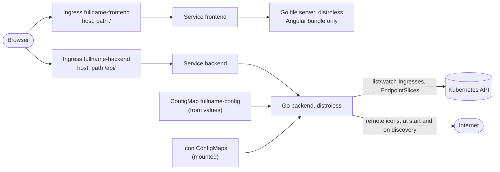

# Project plan

How Dash goes from an empty repository to the dashboard that replaces Hajimari in the
owner's clusters. Phases, not dates: each phase names what it delivers, how that is verified and
what has to be decided first. A phase that closes moves its facts into their homes — the README
reference, `docs/developer/`, `docs/security/`, an ADR — and is deleted from this file; the plan is
consumed, never maintained beside the code (the practice of cowork's ADR 0002 D10 and ADR 0074).

Written 2026-10-26 from the owner's brief of the same day. Every statement about another project
names what was read; what was not checked says so.

**Contents:** [1 Brief](#1-the-brief) · [2 Sources](#2-sources) ·
[3 Working agreements](#3-working-agreements) · [4 Scope](#4-scope) ·
[5 Architecture](#5-architecture) · [6 Discovery](#6-discovery) · [7 Icons](#7-icons) ·
[8 Design](#8-design-cogpits-dark-cockpit-on-the-web) · [9 Helm chart](#9-the-helm-chart) ·
[10 CI, release, Renovate](#10-ci-release-and-renovate) · [11 Test tiers](#11-test-tiers) ·
[12 Security relations](#12-security-relations) · [13 Repository layout](#13-repository-layout) ·
[14 Phases](#14-phases) · [15 Not planned](#15-deliberately-not-planned) ·
[16 Open questions](#16-open-questions)

## 1. The brief

The owner's brief, 2026-10-26:

- A Kubernetes dashboard, installed by a Helm chart.
- App discovery from Ingresses as Hajimari does it, and bookmarks. **No search.**
- Every setting configurable through the chart. **No login.**
- Light, dark or system scheme, chosen in the UI and remembered by the browser.
- Every discovered app and every bookmark has an icon: from an icon library, or provided
  externally — through ConfigMaps (base64 images such as JPEG) or through a URL, which
  Dash downloads at start and serves itself.
- **The look is Cogpit's.** Hajimari is the reference for what discovery does, never for how
  anything looks, and its icon set is not the limit of what we offer (the owner, same day).
- CI with broad test coverage and Renovate as in cowork. Backend Go 1.27.3, frontend Angular
  22.2; `backend/` and `frontend/` apart; two Ingresses in the cluster and no nginx that proxies
  between frontend and backend.
- Added the same day: **distroless containers**, for the smallest attack surface; and **badges** —
  with several Ingress controllers, an icon can carry extra pills in the style of macOS dock
  badges, holding a number, a text or an icon; for example a globe for an endpoint reachable
  worldwide and a house for a local one, told apart by the IngressClass.
- Decided the same day: annotations are read under `dash.gtrfc.com/` only
  ([Q1](#q1--which-annotation-keys-does-discovery-read)).

## 2. Sources

| Source | Used for | What was read (2026-10-26) |
|---|---|---|
| [Hajimari](https://github.com/toboshii/hajimari) | Discovery semantics: annotations, selection, URL, status, configuration options | The source, cloned at `main` (`b07024d`); the newest commit is dated 2023-05-25, so the project has been idle for three and a half years |
| [Cogpit](https://github.com/guided-traffic/cogpit) | The look (Dark Cockpit), the palette, the shapes; the remote icon fetcher | `docs/developer/design-language.md`, `internal/ui/fyneui/theme.go`, `internal/helm/icon.go`, `internal/engine/clustersettings_icon.go`, the README screenshots |
| [cowork](https://github.com/guided-traffic/cowork) | Repository shape, CI, release, Renovate, the chart, two containers, the theme preference | its agent instructions; ADRs 0001, 0003, 0046, 0047, 0052, 0053, 0056, 0061, 0062, 0073, 0074; the three workflows; `renovate.json`; the chart; the original `docs/planning/project-plan.md` (this file's form) |
| The owner's cluster repositories | What the cut-over migrates | `wds18-k8s-apps`, `wds18-flux-apps`, `sutor-k8s-flux-artifacts`, `stutor-k8s-flux-base` (grep) |
| dex-operator, valkey-operator, stackit-s3-provisioner | The organisation's pattern for annotation keys and API groups: `<product>.gtrfc.com` | Their `+groupName` markers and annotation constants (`dex.gtrfc.com`, `vko.gtrfc.com`, `stackit-bucket.gtrfc.com`) |

What the owner's clusters use today (verified by grep, 2026-10-26):

- About thirty manifests carry Hajimari annotations: `hajimari.io/icon` 37 times,
  `hajimari.io/appName` 24, `hajimari.io/enable` 15 (every one `"false"`), `hajimari.io/url` once.
- Hajimari runs in `stutor-k8s-flux-base` (`components/ingress-controller/haproxy-internal/internal-service-dashboard/helmrelease.yml`)
  with `defaultEnable: true`, `namespaceSelector.any: true`, `showAppStatus: true`,
  `showAppUrls: false` and `alwaysTargetBlank: true`. Its own Ingress opts out with
  `hajimari.io/enable: "false"` and carries `cert-manager.io/cluster-issuer`; its pods carry
  network-policy labels (`gnp/internal-backend`, `gnp/k8s-api-access`).
- Every icon value is a bare MDI name (`web` 9 times, `home-automation` 4, then one each); all 27
  distinct names exist in `@iconify-json/mdi` 1.2.3.
- The internal Ingress controller is **haproxy-ingress**, chart 0.15.1.
- Not found: where the wds18 clusters run their Hajimari. Their manifests carry the annotations, but
  no Hajimari release was found in the wds18 repositories.

## 3. Working agreements

- **Decide before building.** An open decision lives in [§16](#16-open-questions) and is worked one
  question per turn; the answer is recorded there at once and becomes an ADR — with phase 1's
  founding records while the repository has none, afterwards in the session it is given. Code on an
  unanswered question is speculation.
- **Cogpit is the visual reference; Hajimari is the reference for discovery semantics only.**
- **Distroless images:** nothing in an image that its process does not need.
- **`make` is the entry point**, locally and in CI. Every tool is pinned once — the Makefile, `go.mod`
  or a lock file — and both read that pin: one version of every tool.
- **No phase closes without its tests** in the tiers of [§11](#11-test-tiers) and without the pages
  that describe what it built.
- **Verification is named:** what ran, against what, with what result.
- Conventional commits without an apostrophe (semantic-release reads them; cowork's rule).

## 4. Scope

| In | Out |
|---|---|
| Ingress discovery with Hajimari's semantics ([§6](#6-discovery)) | Search and search providers (brief) |
| Custom apps and bookmark groups from the chart | Login or any user model in the app (brief); protection is the Ingress controller's ([§12](#12-security-relations)) |
| Every icon source of the brief and more catalogues than Hajimari ([§7](#7-icons)) | Custom colour themes beyond Cogpit's light and dark |
| Light / dark / system, remembered per browser | Hajimari's start pages, modules, experimental features and `Application` CRD |
| Every setting through the chart, validated twice | Editing anything from the UI — the configuration is the chart's |
| Badges on icons, macOS-style, from rules and annotations ([§7.9](#79-badges)) | Badge numbers that change with the cluster ([§15](#15-deliberately-not-planned)) |
| Two Ingress objects, no internal proxy; distroless images | Gateway API routes, metrics, multi-cluster ([§15](#15-deliberately-not-planned)) |

## 5. Architecture



| Part | Responsibility |
|---|---|
| Backend (`backend/`) | Watches Ingresses, EndpointSlices and — for badge rules — IngressClasses through informers; reads the configuration file; resolves and serves every icon and badge; answers `/api/v1/*`, `/healthz`, `/readyz`. It serves no UI. A static binary in a distroless image. |
| Frontend (`frontend/`) | The Angular bundle, served by a small Go file server (`frontend/server/`, standard library only) in a distroless image: every path the router owns resolved to `index.html` (never cached), hashed bundles immutable, the shell's Content-Security-Policy on everything it serves, its own `/healthz`, and a `404` problem for an `/api/` path that reaches it by mistake — the rules of cowork's nginx configuration (ADR 0001 D3 as amended 2026-10-04), without nginx. It loads the bundle into memory at start, takes no configuration and never reaches the backend. |
| Chart (`deploy/helm/dash/`) | Both Deployments and Services, **two Ingress objects**, the configuration, RBAC that follows the namespace selector ([§9](#9-the-helm-chart)). |

**Two Ingress objects, the controller as the only hop.** The owner's brief. cowork renders one
Ingress object with three paths; here `<fullname>-frontend` takes `/` and `<fullname>-backend`
takes `/api/`, both on the same hosts with the same TLS block, each with annotations of its own
on top of a shared set. The browser still sees one origin: no CORS, no second body limit, no
resolver, no proxy configuration to keep in step.

**Live data without push.** The UI asks `GET /api/v1/dashboard` on load, every
`ui.refreshSeconds` and when the tab becomes visible again. The answer comes from the informer
cache, so a page view costs the API server nothing; there is no long-lived stream to keep alive
through the controller.

**Distroless, both images.** The owner's aim is the smallest attack surface: both images are
`gcr.io/distroless/static-debian13:nonroot`, pinned by digest — no shell, no package manager, no
libc; a static Go binary and its files. That is why the frontend is not nginx: no nginx image of
that kind is published with version tags — Chainguard's free `cgr.dev/chainguard/nginx` offers
`latest` and `latest-dev` only (checked 2026-10-26) — and a Go file server of a few hundred lines
is unit-tested, where nginx's configuration could only be checked by running the image. cowork
rejected a Go file server as "a second Go program to maintain for what nginx does by default"
(ADR 0001, Alternatives); the distroless aim outweighs that here. Its own module keeps the
backend's dependencies out of the frontend image, and the frontend image builds from `frontend/`
alone. A pod without a shell is debugged through an ephemeral container.

### Where this differs from cowork

| cowork | Dash | Why |
|---|---|---|
| One Ingress object, three paths | Two Ingress objects | The brief; and per-object annotations (a timeout or rate limit on the API alone) |
| Frontend in `nginxinc/nginx-unprivileged` (Alpine, with a shell and `apk`) | A Go file server in `frontend/server/` on distroless | The distroless aim; unit tests for what nginx's configuration did |
| Backend on `distroless/static-debian12` | Both images on `distroless/static-debian13`, pinned by digest | The newer base (both published, checked 2026-10-26); one base for both images |
| PostgreSQL, migrations on start | No database | Nothing to persist: the cluster is the state, the chart the configuration |
| Configuration is `COWORK_*` variables only (ADR 0001 D7) | One YAML file the chart renders into a ConfigMap; variables only for its path, the listen address and the log level | Bookmark groups, custom apps and label selectors are nested lists; Hajimari reads a file too |
| PrimeNG with a PrimeUI license key (ADR 0052) | No component library: Angular, the CDK where a behaviour needs it, CSS tokens of our own | The UI has no form, no table and no dialog (every setting is the chart's, there is no login); Cogpit's look is custom anyway; no license key to keep out of the repository and pass to CI |
| Integration tier: PostgreSQL, S3, Dex | envtest — a real kube-apiserver and etcd, pinned with a SHA-512 as Cogpit does (`hack/envtest/fetch.sh`) | Discovery is the subject |
| End-to-end: the images behind an nginx stand-in | kind, haproxy-ingress, cert-manager and the chart | The two-Ingress routing, TLS and RBAC need a real cluster and the owner's controller |
| `helm` from the PATH (the owner's machine has v3.21.3, cowork's CI v4.3.0) | Helm pinned in the Makefile, CI calls `make` | One version of every tool |
| Chart checks: lint, template, shell assertions | Plus `values.schema.json`, kubeconform and helm-unittest | The chart has logic: RBAC modes, two Ingresses, the rendered configuration |
| MCP binary, chat, metrics, OIDC | None | Not in scope |

## 6. Discovery

### 6.1 Annotations

Hajimari's behaviour is read from its source (`internal/annotations/annotations.go`,
`internal/kube/wrappers/ingress.go`, `internal/hajimari/ingressapps/filters.go`). Its website lists
eight annotations; the code has nine. Dash reads the same keys under `dash.gtrfc.com/`
and nothing under `hajimari.io/` — the owner's decision
([Q1](#q1--which-annotation-keys-does-discovery-read)) — so a manifest migrates by replacing the
prefix.

| Key | Hajimari (verified in source) | Dash |
|---|---|---|
| `enable` | With `defaultEnable: false` only `"true"` shows an Ingress; with `true` only `"false"` hides it | Same |
| `appName` | The name shown; else the Ingress name | Same |
| `group` | The group; else the namespace | Same |
| `icon` | Contains `//`: the **browser** loads the URL; contains `:`: an Iconify `prefix:name`; else `mdi:` is prepended (`AppGroup.svelte`) | The grammar of [§7.3](#73-the-icon-reference); a URL is fetched by the backend, never by the browser |
| `url` | Overrides the derived URL; parsed with `url.ParseRequestURI`, which accepts any scheme | Same, `http` and `https` only; anything else is ignored with a log line |
| `info` | A short description | Same, rendered as text |
| `targetBlank` | Opens in a new tab; default `false` | Same; `ui.alwaysTargetBlank` wins |
| `instance` | Comma-separated instance names; with `instanceName` set, an Ingress without the annotation is hidden | Same |
| `statusCheckEnabled` | Readiness shown; default `true`; not on the website | Same |
| `badges` | — | New: badge names of [§7.9](#79-badges), comma-separated, each optionally `@<corner>`; `text:<value>` for a text badge |

### 6.2 Selection

- **Namespaces:** `any`, `matchNames`, `labelSelector`; names and label matches are united — as
  Hajimari (`internal/kube/util/namespaces.go`). The RBAC follows the selector ([§9](#9-the-helm-chart)).
- **Instance:** `discovery.instanceName` and the `instance` key, as above.
- **Self-exclusion:** the chart puts the opt-out on its own two Ingresses — what the owner writes by
  hand on Hajimari's Ingress today.

### 6.3 The app's URL

Hajimari takes `tls[0].hosts[0]` with `https`, else `rules[0].host` with `http`, and appends the
first path of the first rule without its trailing slash. That breaks on a wildcard host, on a TLS
block whose hosts are ordered differently from the rules, on a regular-expression path and on a
rule without a host.

Dash takes the first rule with a concrete host; `https` when that host is listed in
any TLS block; the rule's first `Prefix` or `Exact` path when it holds no regular-expression
characters, else `/`. An Ingress with nothing usable and no `url` key is skipped with a log line
naming the reason.

### 6.4 Status

Hajimari lists, per Ingress and per cycle, the EndpointSlices of the Services the Ingress names and
counts their endpoints. Its `GetRatio` rounds ready over total to 0 or 1, so `pctReady` is always 0
or 100 (`internal/kube/util/replicastatusgetter.go`). It sums every slice, so a dual-stack Service
— one slice per address family — counts each pod twice; that follows from the code and was not
run.

Dash counts ready endpoints over all endpoints of those Services, each pod once
(deduplicated by the endpoint's `targetRef`). A tile is **healthy**, **degraded** (some ready),
**down** (none ready) or **unknown** (no endpoints, or the status switched off).

### 6.5 Watching instead of re-listing

Hajimari re-lists every Ingress and every EndpointSlice every 60 seconds and serves the result from
memory (`internal/services/app.go`: a hard-coded ticker, "todo: make time configurable").
Dash runs shared informers for Ingresses and EndpointSlices — Namespaces only for a
label selector — trimmed by a transform to the fields it uses, as Cogpit's cache trims objects
(`internal/cache/trim.go`). A change shows on the UI's next poll.

### 6.6 Hajimari's configuration options

<details>
<summary>Option by option: taken, renamed or left out</summary>

Defaults are those of Hajimari's `internal/config/config.go`, which wins where the website differs.

| Hajimari | Dash |
|---|---|
| `instanceName` | `discovery.instanceName` |
| `defaultEnable` (false) | `discovery.defaultEnable` (false) |
| `namespaceSelector` | `discovery.namespaceSelector` |
| `title` | `ui.title` |
| `name`, `showGreeting` | `ui.greeting.name`, `ui.greeting.enabled` |
| `lightTheme`, `darkTheme`, `customThemes` | Left out: the look is Cogpit's; `ui.defaultTheme` picks `system`, `light` or `dark` |
| `showSearch`, `defaultSearchProvider`, `searchProviders` | Left out: no search |
| `showApps` | `ui.showApps` |
| `showAppGroups` (code: false, website: true) | `ui.showAppGroups` (true) |
| `showAppUrls`, `showAppInfo`, `showAppStatus` | `ui.showAppUrls`, `ui.showAppInfo`, `ui.showAppStatus` |
| `showBookmarks`, `showBookmarkGroups` | `ui.showBookmarks`, `ui.showBookmarkGroups` |
| `alwaysTargetBlank` | `ui.alwaysTargetBlank` |
| `defaultAppIcon` (`mdi:application`) | `icons.defaultAppIcon` (`material-symbols:apps`) |
| `customApps` | `apps` |
| `globalBookmarks`, `showGlobalBookmarks`, start pages, `modules`, `experimental` | `bookmarks`; the rest left out |
| The `Application` CRD (`hajimari.io/v1alpha1`) | Left out ([§15](#15-deliberately-not-planned)) |
| — | New: `ui.refreshSeconds`, `ui.showSummary`, `ui.groupOrder`, `icons.*`, `badges.*` |

</details>

## 7. Icons

### 7.1 What Cogpit uses

- **Fyne's built-in theme icons**: the 97 SVGs of `fyne.io/fyne/v2` v2.8.2 (`theme/icons`), Google's
  Material Icons — `content-copy.svg` carries Material Icons' `content_copy` path — called as
  `theme.WarningIcon()`, `theme.DeleteIcon()` and so on.
- **Glyphs drawn for Cogpit**, "not taken from any other product": network, layers, the Overview's
  gauge, the helm wheel, Flux, the terminal, the layouts, chevrons, the theme toggle — inline SVG in
  seventeen of its Go files under `internal/ui/fyneui/` and `internal/engine/`.
- **Icons from the internet** for Helm charts: `internal/helm/icon.go` (`IconFetcher`: https only,
  no credentials, at most 256 KiB, public addresses only, each request dialled at the address it
  checked) and `engine.CheckIcon` (PNG and JPEG decoded under bounds and re-encoded; an SVG only
  as one self-contained document).

Cogpit has no icon catalogue of its own. What Dash takes from it is the glyph family
(Material) and the fetcher.

### 7.2 Catalogues: far more than Hajimari's

Hajimari offers MDI glyphs and whatever URL a user types. Dash bundles five
catalogues, so no browser request ever leaves the dashboard's origin:

| Prefix | Catalogue | Entries | Kind | Licence | Why |
|---|---|---|---|---|---|
| `mdi` | Material Design Icons (`@iconify-json/mdi` 1.2.3) | 7,638 + 6,363 aliases | Monochrome glyph | Apache-2.0 | The glyphs the owner's manifests name today, all 27 present; bare names resolve here |
| `material-symbols` | Google Material Symbols (`@iconify-json/material-symbols` 1.2.96) | 16,458 + 8,153 aliases; outlined, rounded, sharp | Monochrome glyph | Apache-2.0 | Cogpit's glyph family — the successor of the Material Icons Fyne ships; the UI's own chrome |
| `si` | Simple Icons 16.35.0 (`@iconify-json/simple-icons` 1.2.100) | 3,739 brands | Monochrome brand mark, with its brand colour | CC0-1.0 | Brands: `grafana`, `kubernetes`, `argo`, `prometheus`, `harbor` all present |
| `sh` | [selfh.st icons](https://github.com/selfhst/icons) | 2,968 apps; 2,503 as SVG; about 2,400 with light and dark variants | Full-colour app logo | CC-BY-4.0 (credit required) | Self-hosted apps, lean: 13 MiB of SVG |
| `di` | [Dashboard Icons](https://github.com/homarr-labs/dashboard-icons) | 3,437 apps; 674 with light and dark variants | Full-colour app logo | Apache-2.0 | The most used homelab set; covers apps selfh.st lacks |

About 28,000 glyphs and 6,400 app logos (the two logo catalogues overlap). Another Iconify set —
Tabler (MIT, 2.1 MB), Lucide (ISC, 0.6 MB), Phosphor (MIT, 4.6 MB), the coloured `logos` (CC0,
7.9 MB) — is one entry in the pack manifest; `docs/developer/icons.md` gets the checklist. Logos
are their owners' trademarks; `ATTRIBUTION.md` credits every catalogue and carries selfh.st's
CC BY 4.0 notice. This is not a legal review.

### 7.3 The icon reference

One string, in an annotation or in the values, read in this order:

| Form | Example | Means |
|---|---|---|
| Contains `//` | `https://example.com/logo.png` | Remote: fetched by the backend ([§7.6](#76-remote-icons)) |
| `configmap:<key>` | `configmap:billing.jpg` | A key of a mounted icon ConfigMap ([§7.5](#75-icons-from-configmaps)) |
| `<prefix>:<name>` | `material-symbols:apps`, `sh:grafana` | A bundled catalogue; `simple-icons:`, `selfhst:` and `dashboard-icons:` are accepted for `si:`, `sh:`, `di:` |
| A bare name | `web` | `mdi:web` — Hajimari's legacy rule, kept so that a manifest migrates by replacing the prefix: all 37 icon values of the owner's manifests keep working |

An unknown prefix, a missing name, a missing key or a failed fetch falls back as below; it is never
an empty tile.

### 7.4 Resolution: every app gets an icon, most get their own logo

1. The icon set on the app — `dash.gtrfc.com/icon`, or `icon` in the values. One that does not
   resolve continues down this list.
2. **Auto-match** (`icons.autoMatch`, on by default): no icon set, so the backend looks the app up by
   name in the logo catalogues — the `appName`, the Ingress name, the `app.kubernetes.io/name` label
   of the Ingress or of its Service (EndpointSlices carry their Service's labels; to be verified in
   kind, envtest runs no EndpointSlice controller), the `helm.sh/chart` label without its version.
   Exact matches only, lower case, punctuation as `-`, Dashboard Icons' aliases included.
3. The default: `icons.defaultAppIcon` or `icons.defaultBookmarkIcon`.

**What auto-match gives the owner, measured 2026-10-26:** of 33 app names in the owner's manifests —
the 23 `appName` values and 10 apps named after their role or app directory, written as the
project's name (the role `sterling-pdf` as `stirling-pdf`; whether each Ingress or chart label
carries exactly that name was not checked) — **20 match a logo**: Grafana, Prometheus,
Alertmanager, GitLab, Harbor, Headlamp, Immich, Keycloak, pgAdmin, Home Assistant, Jellyfin,
Vaultwarden, Mealie, Wiki.js, Flowise, Mailu, Stirling-PDF, SearXNG, TeddyCloud, AppDaemon. The 13
others are mostly the owner's own sites and products (`hans-fischer.com`, `timesheet`,
`Guided SSH`, …), plus Galaxy NG and S3 Browser; they keep a glyph or get their logo through a
ConfigMap. selfh.st alone matches 18, Dashboard Icons alone 19; together they cover each other's
gaps (TeddyCloud only in selfh.st, Alertmanager and AppDaemon only in Dashboard Icons).

Today those apps show generic glyphs (`web`, `home-automation`, `pail`), chosen because Hajimari had
no logos. Auto-match fills only an empty icon: when the owner's manifests move to `dash.gtrfc.com/`,
a generic glyph is better left behind where the logo should show, and kept where it was chosen on
purpose.

A wrong match is the risk of matching by name: a generic app name that happens to be a product's.
Exact matching keeps it rare; an explicit icon always wins, and auto-match can be switched off.

### 7.5 Icons from ConfigMaps

- `icons.configMap.files` — a map of file name to base64 content, which the chart renders into
  `<fullname>-icons` as `binaryData` (base64 in YAML is how `binaryData` works).
- `icons.existingConfigMaps` — names of ConfigMaps in the release namespace, mounted read-only.
- Every key is one icon, referenced as `configmap:<key>`. Keys must be unique across all of them;
  the backend refuses to start on a duplicate and names both ConfigMaps.
- Only the release namespace: reading ConfigMaps of other namespaces would need RBAC on ConfigMaps
  cluster-wide, which hold far more than icons. A ConfigMap's data is limited to 1 MiB.
- The content passes the same check as a remote icon ([§7.6](#76-remote-icons)).

### 7.6 Remote icons

The brief's rule: a URL is downloaded at start and served by Dash. Concretely:

- **When:** every URL known at start — the values, and every annotation of the informers' first sync —
  is fetched before `/readyz` turns ready (failures do not block readiness). A URL first seen later,
  on a new Ingress, is fetched when discovered; until then, and after a failure, the tile shows the
  fallback. A failure is retried after an hour (Cogpit's `iconRetryAfter`). There is no periodic
  refresh: a changed remote image arrives with the next start.
- **How:** a port of Cogpit's `IconFetcher` and `CheckIcon` (same organisation, Apache-2.0): https
  only — plain http only for a host in `icons.remote.allowedHosts`; no credentials, no cookies, no
  referrer; at most `icons.remote.maxBytes` (256 KiB) in `icons.remote.timeout` (20 s) and five
  redirects, each re-checked; a host at a loopback, private, link-local or otherwise non-public
  address refused unless `icons.remote.allowPrivateNetworks` or `allowedHosts` admit it, the
  connection dialled at the address that was checked; PNG, JPEG, GIF and WebP decoded under bounds
  and re-encoded as PNG of at most 256 pixels a side, an SVG kept only as one self-contained
  document; at most four downloads at once and `icons.remote.maxEntries` kept.
- **Annotations:** `icons.remote.fromAnnotations` (default true) decides whether a URL in an
  Ingress annotation is fetched at all — see [§12](#12-security-relations), case 2.
- Kept in memory, content-addressed. A restart fetches again.

### 7.7 Serving and rendering

- **One endpoint.** `GET /api/v1/icons/<catalogue>@<version>/<name>.svg` for the catalogues,
  `GET /api/v1/icons/blob/<sha256>.<ext>` for ConfigMap and remote icons; both immutable
  (`Cache-Control: public, max-age=31536000, immutable`), with `X-Content-Type-Options: nosniff`, the
  type from the content check and `Content-Security-Policy: default-src 'none'; style-src
  'unsafe-inline'; sandbox` — an SVG opened on its own runs nothing on the dashboard's origin.
- **The API hands out resolved icons**, `{src, srcDark?, tint}`: the frontend never parses a
  reference. Every fallback is decided in the backend, where the rule "every tile has an icon" is a
  unit test.
- **Two renderings.** A monochrome glyph (`tint: true`) is drawn as a CSS mask filled with the token
  colour, so it follows the scheme and lights up on hover; a full-colour logo is an ``, and its
  dark variant (`srcDark`) is used in the dark scheme. Which file of each catalogue is "for dark
  backgrounds" — their `-light` and `-dark` suffixes — is checked against the catalogues in phase 2.
- **The UI's own chrome** (the theme control, the external-link mark, the status glyphs) is a handful
  of Material Symbols inlined in the frontend bundle: the shell draws even while the backend is down.

### 7.8 Packaging and updates

- The backend image carries the catalogues as **icon packs**: one zip of SVG files plus a manifest
  (catalogue, version, licence, count) per catalogue, built at image build by
  `backend/tools/iconpack` and read at start from a directory — a few files on disk instead of
  ~50,000, random access through the zip index, and memory for the index only. Unit tests run
  against small fixture packs, so `go build` and `go test` need no download.
- **Pins:** the Iconify sets in `backend/icons/package.json` with its lock file (npm integrity
  hashes; Renovate's npm manager). selfh.st and Dashboard Icons publish no tags, releases or npm
  packages (verified 2026-10-26), so each is pinned to a Git commit with the SHA-256 of the fetched
  tree, fetched by a sparse checkout of `svg/` and its index, and moved by a Renovate custom manager
  on a weekly schedule — both repositories push several times a week.
- A test keeps the icon names known to be in use — the owner's 27 MDI names among them, copied once
  into `testdata` — resolving across every catalogue update.

### 7.9 Badges

The owner's requirement: with several Ingress controllers, an icon carries extra pills in the style
of macOS dock badges — a number, a text or an icon; for example a globe for an endpoint reachable
worldwide and a house for a local one, told apart by the IngressClass.

- **Definitions** (`badges.definitions`): named badges, each with an `icon` **or** a `text`, a
  `label` and a `tone`. The icon is a monochrome glyph of `mdi`, `material-symbols` or `si`, tinted
  by the tone — a full-colour logo is unreadable at twelve pixels. The text has at most eight
  characters; a number is a text. The `label` is required: it is the tooltip and the accessible
  name, because a glyph alone says nothing to a screen reader (Cogpit: a light is never the only
  signal). The tone is one of the palette's lights: `neutral` (the default), `blue`, `cyan`,
  `mint`, `amber`, `coral` — coral is macOS's red. Violet stays the agent's.
- **Rules** (`badges.rules`, in order): a `match` and the `badge` it puts on, optionally at a
  `corner`. The match fields are all optional and must all hold: `ingressClassNames`;
  `ingressControllers` — the IngressClass's `spec.controller`, which tells controllers apart even
  where class names differ between clusters; `namespaces`; `hosts` — globs on the app's host such
  as `*.home.arpa`, which also match custom apps and bookmarks by their URL; `labels` — a label
  selector; `annotations` — exact values; `kinds` — `ingress`, `app`, `bookmark`. A field an item
  does not have (an IngressClass for a bookmark) does not match.
- **Per item:** the annotation `dash.gtrfc.com/badges` lists definition names, comma-separated,
  each optionally `@<corner>`; `text:<value>` adds an ad-hoc text badge whose label is its text.
  Custom apps and bookmarks carry `badges` in the values the same way.
- **Corners:** `top-right` (the default, where macOS puts it), `top-left`, `bottom-right`,
  `bottom-left`; one badge per corner — the item's own list takes its corner first, then the first
  matching rule. Four at most, never a stack.
- **The effective IngressClass:** `spec.ingressClassName`, else the legacy annotation
  `kubernetes.io/ingress.class`, else the cluster's default class
  (`ingressclass.kubernetes.io/is-default-class: "true"`). The default and the controller need the
  IngressClass objects: an informer on `ingressclasses`, cluster-scoped, rendered only when a rule
  exists ([§9](#9-the-helm-chart)).
- **Validated at start:** a rule naming an unknown definition, a text over eight characters, a
  missing label, a glyph that does not resolve, the violet tone — the backend refuses to start and
  names each. In an annotation an unknown name is ignored with a log line: an Ingress author's typo
  must not stop the dashboard.
- **In the API:** each app and bookmark carries its resolved `badges: [{corner, icon?, text?,
  label, tone}]`; the look is in [§8](#8-design-cogpits-dark-cockpit-on-the-web).

The owner's example (the class names are examples):

```yaml
badges:
  definitions:
    world: { icon: "material-symbols:public", label: "reachable worldwide", tone: cyan }
    home:  { icon: "material-symbols:home", label: "local network only" }
    beta:  { text: "beta", label: "beta release", tone: amber }
  rules:
    - match: { ingressClassNames: [external] }
      badge: world
    - match: { ingressClassNames: [internal] }
      badge: home
```

and on one Ingress `dash.gtrfc.com/badges: "beta@bottom-left"`. Both glyphs exist in Material
Symbols (checked 2026-10-26).

## 8. Design: Cogpit's Dark Cockpit on the web

The source is Cogpit's `docs/developer/design-language.md` and the palettes in
`internal/ui/fyneui/theme.go`. Cogpit's idea: an aviation cockpit is dark, and when every system is
normal no light is on — only a deviation lights up. A dashboard of apps is that idea's best case.

| Cogpit principle | On the dashboard |
|---|---|
| Quiet when healthy, lit where it matters | A healthy tile draws no colour; a degraded or down app lights up — the whole status design |
| A stage and plates, not boxes | Tiles and bookmark rows are plates one luminance step above the stage; hairlines only where luminance is not enough |
| Three lights, one meaning each | Glow blue `#4aa8ff` is you: focus, hover, links, the chosen theme. Cyan `#5ad1e3` is the cluster: group heads, the summary. Violet stays the agent's and is not used. Status colours only for deviations |
| Tokens for things you count | The summary: one rounded square per app, healthy at about a third of its light |
| Brackets for groups | `monitoring · 4` — a lowercase label with a middle dot over a hairline with end ticks |
| The horizon only where there is no data | The perspective grid and the stage light on the empty state alone |
| Glow is never the only signal | Every state has a word: `2 of 3 ready`, `down` |

**Tokens.** CSS custom properties on `:root`, dark and light, from Cogpit's palettes. Dark: stage
`#0d121a`, chrome `#0a0e14`, plate `#10161f`, lifted plate `#121925`, header `#141b26`, hairline
`#1b2330`, card edge `#263042`, field outline `#3e4f6a`, text `#d5dde8`, muted `#8592a5`, link
`#7cc4ff`, selection `#183252`, stage light `#15233b`; status mint `#3dd68c`, amber `#f2c14e`,
orange `#ff9f5a`, coral `#ff6b74`. Light: the same roles on white plates (stage `#fbfcfd`, chrome
`#eef1f5`, plate `#f7f8fa`, text `#1a2230`, muted `#5f6a7c`, primary `#0a6fd6`, cyan role `#0b7c93`,
error `#d23b45`, success `#138a52`, warning `#c4570e`), the lights deepened for 4.5:1 text.

**Elements.**

| Element | Look |
|---|---|
| Top bar | Chrome, darker than the stage: the title, the greeting and date in muted text, the theme control on the right |
| Theme control | Cogpit's segmented control: one dark plate with a hairline, three segments (system, light, dark) as Material Symbols glyphs, the chosen one a step lighter with a 2-point glow-blue underline; each segment named for screen readers |
| Summary (`ui.showSummary`) | Cogpit's health header: `apps · 42` in cyan, a token per app — healthy dim, degraded amber, down coral — and a legend naming only what is not healthy; a token links to its tile |
| Group head | The bracket: `monitoring · 4`, its hairline at about 55 % of its light with 6-point end ticks; groups 20 points apart |
| Tile | A plate: the icon at 40 px, the name, the URL in muted text (`ui.showAppUrls`), the description (`ui.showAppInfo`). Hover and keyboard focus: Cogpit's glow frame in glow blue, the glyph lit; never two glows in one region |
| Status | Healthy: nothing. Degraded: a 3-point amber spine at the tile's left edge and the pill `2 of 3 ready`. Down: a coral spine, a 6 % coral tint, the pill `down` |
| Badge | macOS's shape and place, Cogpit's colours ([§7.9](#79-badges)): a pill at a corner of the icon with a third of it outside, 18 px high on a 40 px icon, at least as wide as high (a circle for one character or a glyph), a 2 px ring in the plate's colour that cuts it from the icon, as macOS's ring does; filled with its tone, its glyph or text in the tone's content colour. On a bookmark row (20 px icon) badges become small chips after the name |
| Bookmarks | Compact rows under bracket heads: a 20 px icon and the name, a quiet link (text colour, glow blue with an underline under the pointer) |
| Empty state | The horizon behind `no apps discovered`, naming the namespace selector and the instance in effect |
| Motion | Slow and purposeful; none under `prefers-reduced-motion` |
| Width | A grid of tiles; at phone width one column with a 16-pixel gutter and no horizontal scroll |
| Typography | Self-hosted from npm, no font CDN: Inter, Cogpit's own typography proposal (Cogpit itself still draws Fyne's bundled font) |

**The theme preference** — cowork's ADR 0052 D3 model: `system`, `light` or `dark`, stored in
`localStorage` under `dash.theme`; without a stored choice `ui.defaultTheme` applies;
`system` follows `prefers-color-scheme` live. A one-kilobyte `theme-init.js`, loaded from the origin
in `<head>`, applies the stored choice before the first paint (the CSP refuses inline scripts). Where
storage throws — a private window, blocked site data — the choice falls back to `system` and the
page still renders.

**Kept by tests:** a vitest that checks every text, status and badge-tone pair of both palettes for
contrast (4.5:1 for text, 3:1 for shapes), after Cogpit's `TestPaletteContrast`; Playwright screenshots of
both schemes, which also become the README's `<picture>` pairs (`docs/images/<scene>_dark.png` and
`_light.png`, as in Cogpit's README); an axe scan in both schemes.

## 9. The Helm chart

| Resource | Name | Rendered when |
|---|---|---|
| Deployment, Service | `<fullname>-backend` | Always |
| Deployment, Service | `<fullname>-frontend` | Always |
| Ingress, path `/` (`Prefix`) | `<fullname>-frontend` | `ingress.enabled` |
| Ingress, path `/api/` (`Prefix`) | `<fullname>-backend` | `ingress.enabled` |
| ConfigMap (`config.yaml`), checksum on the backend's pods | `<fullname>-config` | Always |
| ConfigMap (`binaryData`) | `<fullname>-icons` | `icons.configMap.files` is not empty |
| ServiceAccount | `<fullname>-backend` | `serviceAccount.create` |
| ClusterRole and ClusterRoleBinding | `<namespace>-<fullname>` | `rbac.create`, selector `any` or `labelSelector` |
| Role and RoleBinding per namespace | `<namespace>-<fullname>` | `rbac.create`, selector `matchNames` only |
| ClusterRole and ClusterRoleBinding on `ingressclasses` | `<namespace>-<fullname>-ingressclasses` | `rbac.create` and `badges.rules` not empty, in every selector mode |

- **RBAC:** `list` and `watch` on `ingresses` (`networking.k8s.io`) and `endpointslices`
  (`discovery.k8s.io`); on `namespaces` only for a label selector; on `ingressclasses` —
  cluster-scoped, a name, a controller and a parameters reference — only when badge rules exist,
  so the `matchNames` mode then gets this one small ClusterRole. Nothing on Secrets or ConfigMaps:
  icon ConfigMaps are mounted, not read through the API. Hajimari's chart grants `get` and `list` on
  ingresses, namespaces and endpointslices cluster-wide, whatever its namespace selector.
- **Both Ingresses** carry `ingress.hosts`, `ingress.tls`, `ingress.className` and
  `ingress.annotations`; `ingress.frontend.annotations` and `ingress.backend.annotations` add to their
  own object. cert-manager's annotation belongs under `ingress.frontend.annotations` only: both
  objects name the same TLS secret, and one Certificate is made for it. Not verified until phase 1's
  end-to-end tier: cert-manager's ingress-shim with that split, and haproxy-ingress merging two
  objects of one host.
- **Pods:** both distroless and non-root (65532), read-only root filesystem without a writable
  volume, all capabilities dropped, no privilege escalation, `RuntimeDefault` seccomp, `GOMEMLIMIT`
  from the memory limit; the frontend without a ServiceAccount token — cowork's ADR 0001 D8, minus
  nginx's `/tmp`.
  Per pod: replicas, resources, labels, annotations, node selector, tolerations, affinity, image
  overrides and pull secrets. The owner's clusters admit traffic by pod labels (`gnp/*`, seen on
  Hajimari): `backend.podLabels` carries them, egress to the internet for remote icons included.
- **No NetworkPolicy:** the cluster administrator's, as in cowork.
- **Validated twice:** `values.schema.json` refuses a wrong type at `helm install`; the backend
  refuses an invalid configuration at start and names every invalid key at once.

<details>
<summary>The values, as phase 2 leaves them (defaults where they exist, examples marked)</summary>

```yaml
backend:
  image: { repository: guidedtraffic/dash-backend, tag: "", pullPolicy: IfNotPresent }
  replicas: 1
  logLevel: info
  resources: {}
  podLabels: {}            # example: { gnp/k8s-api-access: "" }
  podAnnotations: {}
  nodeSelector: {}
  tolerations: []
  affinity: {}
frontend:
  image: { repository: guidedtraffic/dash-frontend, tag: "", pullPolicy: IfNotPresent }
  replicas: 1
  resources: {}
  podLabels: {}
  podAnnotations: {}
  nodeSelector: {}
  tolerations: []
  affinity: {}
imagePullSecrets: []
serviceAccount: { create: true, name: "", annotations: {} }
rbac: { create: true }

ingress:
  enabled: false
  className: ""
  hosts: []                # example: [dashboard.example.com]
  tls: []                  # example: [{ secretName: dashboard-tls, hosts: [dashboard.example.com] }]
  annotations: {}          # on both Ingresses
  frontend: { annotations: {} }   # <fullname>-frontend, path /   — cert-manager goes here
  backend:  { annotations: {} }   # <fullname>-backend,  path /api/

discovery:
  enabled: true
  defaultEnable: false
  instanceName: ""
  namespaceSelector: { any: true, matchNames: [], labelSelector: {} }
  # annotations: dash.gtrfc.com/<key> only; hajimari.io/* is ignored

ui:
  title: Dash
  greeting: { enabled: true, name: You }
  defaultTheme: system     # system | light | dark
  refreshSeconds: 60
  showSummary: true
  showApps: true
  showAppGroups: true
  showAppUrls: true
  showAppInfo: false
  showAppStatus: true
  showBookmarks: true
  showBookmarkGroups: true
  alwaysTargetBlank: false
  groupOrder: []           # example: [monitoring, home]

apps: []                   # example: [{ group: tools, apps: [{ name: Router, url: "https://192.168.1.1", icon: "material-symbols:router", info: "", targetBlank: true }] }]
bookmarks: []              # example: [{ group: docs, bookmarks: [{ name: Kubernetes, url: "https://kubernetes.io/docs", icon: "si:kubernetes", targetBlank: true }] }]

icons:
  defaultAppIcon: material-symbols:apps
  defaultBookmarkIcon: material-symbols:bookmark
  autoMatch: { enabled: true, catalogs: [selfhst, dashboard-icons] }
  configMap: { files: {} } # example: { billing.jpg: <base64> } → configmap:billing.jpg
  existingConfigMaps: []   # example: [team-icons]
  remote:
    enabled: true
    fromAnnotations: true
    allowPrivateNetworks: false
    allowedHosts: []
    maxBytes: 262144
    timeout: 20s
    maxEntries: 512

badges:
  definitions: {}          # example: { world: { icon: "material-symbols:public", label: "reachable worldwide", tone: cyan } }
  rules: []                # example: [{ match: { ingressClassNames: [external] }, badge: world, corner: top-right }]
```

</details>

## 10. CI, release and Renovate

cowork's pipeline, job for job, adapted. Every job runs a `make` target; every verification job is
in `semantic-release`'s `needs:` (cowork ADR 0003 D4); every action is named by a version tag
(ADR 0061 D7); runners are the organisation's self-hosted pool. The Go jobs run over both Go
modules, `backend/` and `frontend/server/`.

| Job (`release.yml`, "Test and Release") | Target | Proves |
|---|---|---|
| Code Linting | `make lint generate-check` | golangci-lint; the generated server, client and API bundle are current |
| GoSec Security Scan | `make gosec` | |
| Vulnerability Check | `make vuln` | govulncheck |
| Cyclomatic Complexity | `make cyclo` | gocyclo at 15, tests excluded |
| Malware Scan (Source Code) | ClamAV | |
| Unit Tests | `make test-unit-coverage` | Backend unit tier |
| Integration Tests (envtest) | `make test-integration-coverage` | Discovery against a real API server, RBAC included |
| Frontend (lint, test, build) | `make frontend-install frontend-generate-check frontend-lint frontend-test-coverage frontend-build` | |
| Helm Chart | `make helm-lint helm-template helm-unittest helm-kubeconform` | Every `ci/*-values.yaml`; template assertions; manifests against the Kubernetes schemas |
| Combined Coverage Report | — | Backend unit + integration merged, frontend lines; sticky PR comment with per-package table and the difference to `main`; the badge |
| Container Malware Scan (backend, frontend) | Trivy | Each image builds from its own directory, passes CRITICAL/HIGH and has no shell |
| End-to-End Tests | `make e2e` | [§11](#11-test-tiers) |
| Release Tooling | `make test-release-tooling` | semantic-release still renders notes |
| Semantic Release | — | `needs:` every job above; GitHub App token, so the release starts the next workflow |

- **`build.yml`** ("Release Docker & Helm", on a published release): both images to Docker Hub as
  `guidedtraffic/dash-backend` and `-frontend` (SBOM, provenance, Docker Scout); the
  chart to GitHub Pages at `https://guided-traffic.github.io/dash/`. `linux/amd64` as
  cowork builds.
- **`renovate.yml`**: self-hosted Renovate, daily at 02:00 Europe/Berlin, the GitHub App's token,
  filtered to this repository.
- **`renovate.json`**: cowork's rules — Go version grouped across `go.mod`, the Containerfile, the
  workflow and the release template, patches at once and minors after seven days (ADR 0062); Go
  modules and frontend npm minor and patch automerged, majors by hand; Angular as one group;
  TypeScript held to Angular's peer range; GitHub Actions automerged, majors included; Makefile pins
  through the custom regex manager. Without cowork's PostgreSQL, Silo, Dex, sqlc, PrimeNG and nginx
  rules. New: the distroless base pinned by digest and automerged (`:automergeDigest`, which cowork
  extends too); Go in both `go.mod` files and both Containerfiles, one group; the icon packs of
  [§7.8](#78-packaging-and-updates); the kind node image, the haproxy-ingress and cert-manager
  charts, the envtest Kubernetes version, Helm, helm-unittest, kind and kubeconform.

**What only the owner can do** (organisation administrator rights; nothing in this repository can):
install the GitHub App `guided-traffic-automation` on the repository and add `APP_CLIENT_ID` and
`APP_PRIVATE_KEY`; add `DOCKERHUB_PAT` and create the two Docker Hub repositories; create
`gh-pages` and turn on Pages; admit the repository to the runner group; add the rulesets of cowork's
ADR 0073 (pull requests, every job required, squash only, auto-merge, release tags protected).

## 11. Test tiers

Coverage is measured and shown on every pull request, not gated by a number (cowork ADR 0003 D5).
Orientation, not gate: backend lines at 80 % or above, and every branch of discovery and icon
resolution covered by a table test.

| Tier | Target | Needs | Proves |
|---|---|---|---|
| Backend unit | `make test-unit` | Nothing | Configuration (every invalid key at once); every annotation key under `dash.gtrfc.com/`, and a `hajimari.io/` key ignored; selection (`defaultEnable` × `enable` × `instance`); URL derivation (TLS, wildcard, regular-expression path, missing host, invalid `url`, non-http schemes); status (deduplication, dual stack, none ready); grouping and order; the icon grammar and every fallback; auto-match; the fetcher against `httptest` (size, time, type, magic bytes, redirects, loopback, private and link-local addresses, a name that resolves elsewhere a moment later); ConfigMap keys and duplicates; badges — every match field, their conjunction, rule order, one badge per corner, the effective class (field, legacy annotation, default class), the validation of definitions; handlers against the OpenAPI document; problem details; shutdown — with `client-go`'s fake clientset where informers are involved |
| Backend integration | `make test-integration` (tag `integration`) | envtest binaries (`make envtest-bin`) | Discovery against a real API server: Ingresses, Services and EndpointSlices created, changed and deleted, and the dashboard following within a bound; the discovery running as the chart's ServiceAccount with exactly the RBAC `helm template` renders, in each selector mode, and refused on what it must not read. Fails, never skips, without the binaries |
| Frontend unit | `make frontend-test` | Node.js 26 | The theme service (three states, storage, the media query, storage that throws); the icon component (mask, image, dark variant); the badge pill (corner, glyph or text, tone); tile states and their words; polling and visibility; the contrast of every token pair |
| Frontend server unit | `make test-unit` (module `frontend/server`) | Nothing | Every router path resolved to `index.html` with `no-store`; hashed files immutable; the CSP on every UI response; the `404` problem for `/api/`; no directory listing and no path outside the bundle; `HEAD`, ranges, gzip, ETags; `/healthz`; shutdown |
| Chart | `make helm-lint helm-template helm-unittest helm-kubeconform` | Helm (pinned) | Both Ingresses and their annotations; self-exclusion; RBAC per selector mode; the IngressClass ClusterRole when badge rules exist; the icon ConfigMap; the rendered configuration; the schema refusing invalid values |
| Container | Trivy, one leg per image | Docker | Each Containerfile builds from its directory; no fixable CRITICAL or HIGH; neither image has a shell (`docker run --entrypoint /bin/sh` fails) |
| End-to-end | `make e2e` | Docker, kind (pinned) | In kind with haproxy-ingress and cert-manager, the chart installed with the images the container tier built and TLS on both Ingresses; Playwright in Chromium and WebKit, both schemes, at desktop and phone width: tiles from `dash.gtrfc.com` annotations while a `hajimari.io` annotation changes nothing, opt-out, instance filter, custom apps, bookmark groups, an icon of every source (a catalogue glyph, a logo with its dark variant, a ConfigMap image, a remote icon from a fixture server admitted by `allowedHosts`, and a private URL refused by default), auto-matched logos, badges by IngressClass — two classes, one served by haproxy-ingress and one whose controller is not installed — and by annotation, a Deployment scaled to zero turning its tile `down`, a new Ingress appearing on the next poll, the theme choice surviving a reload, no axe violation of serious or critical impact; the README screenshots as a by-product |
| Release tooling | `make test-release-tooling` | Node.js | The semantic-release set renders notes |

No `-short`, no `testing.Short()`, no skip on a missing dependency (cowork ADR 0003 D3). A fix comes
with the test that failed without it.

## 12. Security relations

Only where a real relation exists; each becomes a page under `docs/security/`, ending with
`## What this does not cover`, where an open gap gets its `H-<n>`.

| # | Case | Who | Where | Live? | What makes it real | Answer | Page |
|---|---|---|---|---|---|---|---|
| 1 | The app inventory without a login | Anyone who reaches the dashboard's host | `GET /api/v1/dashboard`, the UI | From the first install | Names, URLs, groups (namespaces by default) and readiness of every discovered app, to whoever reaches an Ingress class that is reachable from outside | The owner's practice: an internal Ingress class (seen on Hajimari). **Two-Ingress trap:** a forward-auth, basic-auth or allowlist annotation under `ingress.frontend.annotations` protects the UI only — `/api/` keeps serving the whole inventory. Such annotations belong under `ingress.annotations`, which both objects carry; the README and the chart's notes say so | `exposure.md` |
| 2 | Requests into the cluster's networks through icon URLs (SSRF) | Whoever may create or update Ingresses in a watched namespace | The backend's fetch of an annotation's URL, whose bytes it then serves to every viewer | While `icons.remote.fromAnnotations` is on (the default) | Backend egress to non-public addresses: the cloud metadata address, the API server, internal services | The fetcher's rules of [§7.6](#76-remote-icons): public addresses only, dialled where checked, https, bounded, the content re-encoded; escape hatches `allowPrivateNetworks` and `allowedHosts` named as such | `remote-icons.md` |
| 3 | A script in a served SVG | Whoever controls a remote file, a ConfigMap of the release namespace, or a catalogue (community submissions) | An icon URL opened on its own, on the dashboard's origin | For every SVG served | SVG may carry script that runs when the file is a document, not an image | The sandbox CSP, `nosniff`, the type from the content check, SVG only as one self-contained document, rendering only as `` or a mask | `served-icons.md` |
| 4 | A `javascript:` link, markup in a badge | Whoever may annotate an Ingress, or write the values | The `url` key, `apps`, `bookmarks`, the `badges` key | Dormant here | Hajimari parses `url` with `url.ParseRequestURI`, which accepts any scheme (verified in source); whether its Svelte frontend renders such a link live was not tested | Only `http` and `https` accepted; Angular's URL sanitisation as the second line; badge text rendered as text, at most eight characters; an unknown badge name ignored with a log line | `validation.md` |
| 5 | The backend's read on the cluster | Anyone who takes over the backend's pod and its token | The ServiceAccount's RBAC | From the first install | Every Ingress — hosts, TLS secret names and all annotations, where some controllers keep auth and allowlist settings — and every EndpointSlice (pod addresses) of the selected namespaces, cluster-wide with `any`; every IngressClass while badge rules exist | Nothing on Secrets or ConfigMaps; `matchNames` renders namespaced Roles only; the API returns derived fields, never an annotation; distroless, read-only | `privilege-footprint.md` |
| 6 | Exhaustion through many icon URLs | Whoever may annotate Ingresses | The remote icon cache | While `fromAnnotations` is on | Memory and egress grow with every distinct URL | `maxEntries`, `maxBytes`, four downloads at once, a failure remembered for an hour | `remote-icons.md` |
| 7 | The supply chain of the icon packs | The catalogues' maintainers and hosting | The image build | At every build | A changed upstream file lands in the image | Commits and versions pinned with checksums, Renovate pull requests through every tier, the pack builder applying the SVG check of case 3, Trivy and ClamAV on the image | `supply-chain.md` |

`trust-boundaries.md` draws the picture (browser, controller, frontend, backend, API server, icon
hosts) with these cases on it.

## 13. Repository layout

The target tree; phase 1 creates it, phase 2 fills it.

```text
dash/
├── backend/                         # Go module github.com/guided-traffic/dash/backend
│   ├── api/                         # openapi.yaml, components/, oapi-codegen.yaml, openapi.gen.json (generated), embed.go
│   ├── cmd/dash/                    # serve, version
│   ├── internal/
│   │   ├── api/  (apigen/)          # handlers; the generated strict server
│   │   ├── config/                  # the file and three variables → Config, every invalid key at once
│   │   ├── discovery/               # informers, annotation reading, selection, URL, status
│   │   ├── dashboard/               # groups, apps, bookmarks, summary
│   │   ├── icons/                   # grammar, packs, auto-match, ConfigMap source, fetcher and check, cache, serving
│   │   ├── httpserver/              # health, request id, request log, recovery, lifecycle
│   │   └── problem/                 # RFC 9457 bodies and their codes
│   ├── icons/                       # package.json + lock of the Iconify sets; the pins of selfh.st and Dashboard Icons
│   ├── tools/iconpack/              # builds the icon packs at image build
│   ├── test/integration/            # envtest tier
│   ├── Containerfile                # golang:1.27.3-alpine → distroless/static-debian13:nonroot
│   └── .golangci.yml
├── frontend/                        # Angular 22.2 workspace, project "frontend"
│   ├── src/app/                     # api/ (generated), core/ (theme, dashboard), design/ (tokens, shapes), features/dashboard/, shared/
│   ├── public/                      # favicon.svg, theme-init.js
│   ├── e2e/                         # Playwright: specs, support, screenshots
│   ├── server/                      # Go module …/frontend/server, standard library only: the image's file server
│   ├── proxy.conf.mjs               # ng serve → backend for /api: the developer's stand-in for the Ingress
│   └── Containerfile                # node:26-alpine (bundle) → golang:1.27.3-alpine (server) → distroless/static-debian13:nonroot
├── deploy/helm/dash/                # Chart.yaml, values.yaml, values.schema.json, templates/, ci/*-values.yaml, tests/
├── hack/
│   ├── kind/                        # cluster.yaml; haproxy-ingress and cert-manager values; seed manifests
│   ├── envtest/fetch.sh             # from Cogpit
│   └── verify-release-tooling.mjs
├── docs/
│   ├── adr/                         # decisions
│   ├── developer/                   # README, repository-layout, architecture, build-test-lint, testing, ci-and-release, conventions, adding-things, discovery, icons, frontend
│   ├── security/                    # README and one page per case of §12
│   └── planning/project-plan.md     # this file, until phase 3 closes
├── .github/                         # workflows/{release,build,renovate}.yml, badges/coverage.json, release-template.hbs
├── Makefile, renovate.json, .releaserc.json, package.json (semantic-release)
└── AGENTS.md, README.md, SECURITY.md, ATTRIBUTION.md, LICENSE
```

Names the README's naming table will carry: images `guidedtraffic/dash-{backend,frontend}`;
chart `dash` at `https://guided-traffic.github.io/dash/`; resources
`<fullname>-backend`, `<fullname>-frontend`, `<fullname>-config`, `<fullname>-icons`; variables
`DASH_CONFIG` (default `/etc/dash/config.yaml`),
`DASH_LISTEN_ADDR` (`:8080`), `DASH_LOG_LEVEL` (`info`); the browser's
storage key `dash.theme`; the API under `/api/v1/`; the annotation prefix
`dash.gtrfc.com/`.

## 14. Phases

### Phase 1 — Skeleton, CI and release pipeline

**Status 2026-10-26: built on branch `phase-1/skeleton`, verified locally, waiting for GitHub.**
Every local target ran green on the owner's darwin-arm64 machine: `make lint generate-check gosec
vuln cyclo test-unit-coverage test-integration-coverage coverage-report` (Go coverage 85.2 %, both
modules), `make frontend-lint frontend-test-coverage frontend-build frontend-generate-check`
(148 tests, 100 % of the frontend's statements), `make helm-lint helm-template helm-unittest
helm-kubeconform` (21 chart tests), `make docker-build` (both images distroless, no shell),
`make test-release-tooling`, and `make e2e` — 24 Playwright tests in Chromium and WebKit, both
schemes, in kind behind haproxy-ingress 0.16.2 with cert-manager v1.21.3. That run settled two
questions of this phase: haproxy-ingress merges the two Ingress objects of one host, and cert-manager
issues the shared certificate from the annotation on the frontend's object alone. **Not verified
until the first pull request runs:** the workflows on the runners, Renovate, the release, the push to
Docker Hub (the repositories do not exist yet), the chart on Pages; the ruleset on `main` follows the
first run.

**Goal:** every gate of cowork's pipeline runs on a walking skeleton, a release publishes both
images and the chart, and the two-Ingress routing is proven in a real cluster on every pull request.

**Needs:** nothing open.

**Delivers:**

- The tree of [§13](#13-repository-layout); `AGENTS.md`; a README in the documentation standard's
  order (badges only for files that exist); `SECURITY.md`; `ATTRIBUTION.md`; `docs/developer/`
  (README, repository-layout, build-test-lint, testing, ci-and-release, conventions);
  `docs/security/` (README, trust-boundaries, privilege-footprint, exposure).
- The founding ADRs from this plan: two containers and two Ingresses; documentation homes and the
  plan consumed; test and CI policy; configuration as one validated file; design language and no
  component library; toolchains and Renovate; discovery semantics; icon sources, packs and
  resolution; the remote fetch policy; annotations under `dash.gtrfc.com/` only (Q1).
- **Backend:** the module; `dash serve | version`; configuration; `/healthz`, `/readyz`,
  `GET /api/v1/version`, `GET /api/v1/openapi.json`; spec-first with oapi-codegen's strict server and
  kin-openapi validation (cowork ADR 0046); RFC 9457 problems (ADR 0047); the request log without
  query, headers or bodies; graceful shutdown; the Containerfile.
- **Frontend:** an Angular 22.2 workspace — standalone, zoneless, signals, vitest on jsdom,
  angular-eslint; the client generated by ng-openapi-gen; the tokens of [§8](#8-design-cogpits-dark-cockpit-on-the-web)
  in both schemes; the theme service, its segmented control and `theme-init.js`; a shell showing the
  title and the backend's version; the file server in `frontend/server/` with its unit tests;
  `proxy.conf.mjs`; the distroless Containerfile. Design
  tokens and the theme come first because every later component is built on them — cowork's "dark
  mode from the first screen" (ADR 0052 D3).
- **Chart:** both Deployments and Services, both Ingresses, the configuration ConfigMap with its
  checksum, the ServiceAccount, the pod hardening, the schema for what exists, `NOTES.txt`,
  `ci/*-values.yaml`, the first helm-unittest suite.
- **Makefile** with every target of [§10](#10-ci-release-and-renovate) and [§11](#11-test-tiers),
  each tool pinned with a `# renovate:` comment and installed under a versioned name in `bin/`:
  golangci-lint, gocyclo, gosec, govulncheck, oapi-codegen, kubeconform, Helm, helm-unittest, kind,
  the kind node image, the haproxy-ingress and cert-manager charts, the envtest Kubernetes version
  with its SHA-512 per platform (darwin-arm64 and linux-amd64, as Cogpit pins it).
- `release.yml`, `build.yml`, `renovate.yml`, `renovate.json`, `.releaserc.json`, `package.json`,
  `.github/release-template.hbs`, `.github/badges/coverage.json`.
- **The integration tier's harness:** envtest fetched and started, one test proving the backend's
  client reaches it — the job exists and is required from the first day.
- **The end-to-end harness:** `hack/kind` with haproxy-ingress and cert-manager (a self-signed
  issuer); `make e2e` loads the scanned images into kind and installs the chart with TLS on both
  Ingresses; the smoke: the shell over https through the frontend Ingress, `/api/v1/version` through
  the backend Ingress, the theme choice surviving a reload, both schemes, Chromium and WebKit.

**Verified when:** a pull request with the skeleton has every job green and the ruleset requires
them all; both images are distroless, with no shell in either; after the merge semantic-release cuts `0.1.0`, `build.yml` publishes both images and the
chart index; `helm repo add` and `helm install` from the published repository into a fresh kind
cluster serve the shell and `/api/v1/version` through the two Ingresses; Renovate's first run opens
its dependency dashboard and automerges a patch through the gates; the local targets run on the
owner's darwin-arm64 machine with the pinned tools.

**Not verified until then:** haproxy-ingress merging two Ingress objects of one host; cert-manager's
ingress-shim with the issuer annotation on one object and the secret on both; helm-unittest under
Helm 4 (fallback: Makefile assertions as in cowork); kind on the runner pool for this repository
(Cogpit's CI runs kind there through `helm/kind-action`, so it is likely, not proven); envtest's API
server with RBAC authorisation for the impersonation test.

**Effort:** M — most of it is cowork's pipeline ported; new are kind, envtest and the chart tests.

### Phase 2 — The dashboard

**Status 2026-10-26:** each step is one commit on `main` (the owner's choice), not a pull request.

- Step 1 (configuration) on `main`: facts in ADR 0004 (D5, D6),
  `docs/developer/configuration.md`, `docs/security/validation.md`, the README's reference.
- Step 2 (discovery) built with the chart's RBAC, verified locally (`make lint cyclo gosec vuln
  test-unit test-integration helm-* e2e`): facts in ADR 0007 (D4 amended, D6, D7), ADR 0010,
  `docs/developer/discovery.md`, `docs/security/privilege-footprint.md` (H-4), the README's
  annotation table. The RBAC objects are named `<release namespace>-<fullname>`, not `<fullname>`
  as §9 had them, so that two releases of one name do not collide; the chart's RBAC moved from step
  7 into this step, because the discovery needs it to turn ready.
- Step 3 (API) built: `GET /api/v1/dashboard`, validated against the document in the tests, the
  Angular client regenerated; facts in the README's endpoint table, `docs/security/exposure.md`,
  `docs/developer/discovery.md`. `GET /api/v1/icons/…` moves to step 4: without the packs there is
  nothing to serve.
- Steps 4 to 8 open.

**Goal:** the brief end to end — discovery, custom apps, bookmarks, every icon source, Cogpit's
look, every setting through the chart.

**Needs:** nothing open — [Q1](#q1--which-annotation-keys-does-discovery-read) is decided.

**Delivers**, one commit on `main` per step, each with its tests and its pages:

1. **Configuration:** the values of [§9](#9-the-helm-chart) → `config.yaml` → `Config`; the schema
   complete; the README's reference tables.
2. **Discovery:** informers, the annotation reader, selection, the URL, status, grouping and order,
   self-exclusion; the unit tables and the envtest suite with the RBAC of each selector mode.
3. **API:** `GET /api/v1/dashboard`, `GET /api/v1/icons/…`; responses validated against the
   document in the tests.
4. **Icons:** the pack builder and the five packs, the grammar, resolution with auto-match, the
   ConfigMap source, the fetcher and check ported from Cogpit, the cache, the serving headers; the
   address matrix of the fetcher.
5. **Badges:** definitions, rules, the effective IngressClass, the `badges` key, the validation at
   start; the rule matrix.
6. **UI:** the page of [§8](#8-design-cogpits-dark-cockpit-on-the-web) — top bar, summary, groups,
   tiles with their badges, status, bookmarks, the empty horizon, polling with visibility; vitest
   per component.
7. **Chart:** the RBAC modes and the IngressClass role, the icon ConfigMap, the remote settings, the
   badge values, the annotations of both Ingresses, the notes; a helm-unittest case per mode.
8. **End-to-end and pages:** the suite of [§11](#11-test-tiers); `docs/developer/` discovery, icons,
   frontend, adding-things; `docs/security/` for every case of [§12](#12-security-relations); the
   README complete — features, naming conventions, TL;DR, the full reference of every value and
   every annotation key, the light and dark screenshots, and the move from Hajimari: the keys with
   the prefix replaced, opt-out mode, which icon glyphs to leave behind.

**Verified when:** the end-to-end suite is green on every push; a kind fixture that copies the
owner's annotation patterns with the prefix replaced — `defaultEnable: true` with opt-outs, bare MDI
names, `appName`, one `url` — renders the expected tiles, compared against a golden list; each RBAC mode has its chart
test and its envtest run; the schema refuses each invalid value of a table; every case of §12 has
its page; coverage is on every pull request.

**Effort:** L.

### Phase 3 — Cut-over and 1.0

**Goal:** Dash replaces Hajimari in the owner's clusters.

**Delivers:**

- The owner's manifests in `wds18-k8s-apps`, `wds18-flux-apps` and `sutor-k8s-flux-artifacts` carry
  `dash.gtrfc.com/*` beside their `hajimari.io/*`: the prefix replaced, the fifteen opt-outs
  included, generic icon glyphs left behind where a logo should show — changes made in those
  repositories, not from here.
- A release installed beside Hajimari in the stutor cluster (`internal-ingress`); its two Ingresses
  opted out of Hajimari through `ingress.annotations` (`hajimari.io/enable: "false"`), since
  Hajimari runs in opt-out mode there. The two app lists compared, every difference fixed or named.
- The owner swaps the HelmRelease in `stutor-k8s-flux-base`, and the wds18 clusters likewise once
  their Hajimari is located; then the `hajimari.io/*` annotations leave the manifests.
- Every `H-<n>` closed or accepted by the owner; `1.0.0` on the owner's word.

**Verified when:** the owner's clusters run Dash only and no manifest carries
`hajimari.io/*` any more; at the cut-over its app list matched Hajimari's apart from named
differences; what runs is a published release.

**Effort:** S–M — the manifests of three repositories move first.

## 15. Deliberately not planned

- **Search** and search providers — the brief.
- **A login** or any identity in the app — the brief; [§12](#12-security-relations) case 1 says how
  an installation protects it.
- **Discovery from Gateway API routes.** Kubernetes retired ingress-nginx in March 2026 (cowork's
  ADR 0001, Alternatives), and `HTTPRoute` is where Ingress goes; the owner's clusters use Ingress
  with haproxy-ingress today. The first candidate after 1.0.
- Hajimari's `Application` CRD, start pages, modules and custom themes.
- **Metrics** (a listener, ServiceMonitor) — a candidate when an installation asks for alerts.
- **arm64 images** — cowork builds `linux/amd64` only; with build stages on `$BUILDPLATFORM` it is a
  line in `build.yml` when a cluster needs it.
- Live push (SSE): the UI polls a cache, which costs the API server nothing.
- **Badge numbers that change with the cluster** — macOS's red count, such as endpoints not ready:
  the status spine and its word say that already; such a source is one more rule field when wanted.
- Several clusters in one dashboard.

## 16. Open questions

None open. A new open decision is worked one per turn; its answer is recorded here and becomes an
ADR ([§3](#3-working-agreements)).

### Q1 — Which annotation keys does discovery read?

**Decided 2026-10-26 by the owner: `dash.gtrfc.com/*`, exclusively.** Nothing under `hajimari.io/`
is read. The prefix follows the organisation's pattern `<product>.gtrfc.com` — `dex.gtrfc.com`
(dex-operator), `vko.gtrfc.com` (valkey-operator), `stackit-bucket.gtrfc.com`
(stackit-s3-provisioner); gtrfc.com is served from the owner's `wds18-k8s-apps`. Phase 1 writes it
as a founding ADR.

Rejected: our own prefix with `hajimari.io/*` read as a fallback (the recommendation, under which
the owner's clusters would have rendered on the first install); `hajimari.io/*` alone (another
project's name space).

What follows:

- The keys keep Hajimari's names — `enable`, `appName`, `group`, `icon`, `url`, `info`,
  `targetBlank`, `instance`, `statusCheckEnabled` — plus `badges`, so a manifest migrates by
  replacing the prefix; bare MDI names stay valid for the same reason ([§7.3](#73-the-icon-reference)).
- About thirty manifests in three repositories get the new keys before Dash shows the
  owner's apps correctly; until the fifteen opt-outs are carried over, a dashboard with
  `defaultEnable: true` shows the Ingresses they hide.
- Phase 3 still runs both dashboards side by side: each manifest carries both sets during the
  transition, and the `hajimari.io/*` set leaves after the cut-over.
- The icon order is the annotation, then auto-match, then the default: a Hajimari glyph carried over
  wins over a logo, so the migration decides per app which to keep
  ([§7.4](#74-resolution-every-app-gets-an-icon-most-get-their-own-logo)).
- A test proves the exclusivity: a `hajimari.io/*` annotation changes nothing
  ([§11](#11-test-tiers)).
